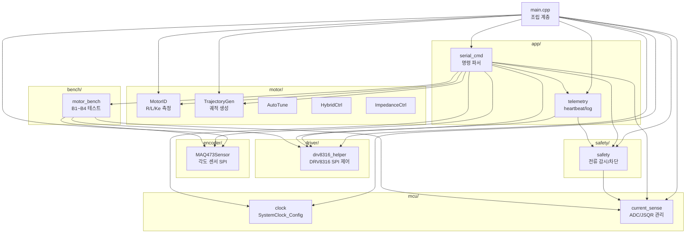

# Custom Mini Motor Driver

내장 ST-Link 업로드·디버깅·UART VCP 설정은
[ST-Link 연결 문서](hardware/ST_Link/README.md)에 정리했습니다.

기본 빌드 환경은 **STM32H723ZGT6 (`custom_h723`)**입니다.
핀맵, 변경 파일, CubeMX 설정과의 차이 및 검증 결과는
[STM32H723 이식 기록](hardware/STM32_H723/README.md)을 참고하세요.
아래 G431 설명은 기존 보드 환경에 대한 기록입니다.

H723 엔코더는 **TLI49012**를 사용합니다. SPI·SysCal·참조각 LUT·모터 없는 시험 방법은
[엔코더 모듈 문서](hardware/encoder/TLI49012E0001XTMA1/README.md)에 정리했습니다.

STM32G431 + DRV8316 + SimpleFOC 기반 **FOC 전류 제어 시스템**  
Maxon EC-i 460720 (14-pole, 36V, 84.8mNm) BLDC 모터 최적화

## 핵심 성능

| 항목 | 달성값 |
|------|--------|
| FOC 루프 | 50kHz PWM, foc_current 토크 제어 |
| 전류 추적 | σ < 5mA, R² = 1.000 |
| 위치제어 | OS = 1.0%, SSE = 0.53°, 리플 -50% |
| 중력보상 | 50~250g, 드리프트 < 0.05mm/s |
| 반복성 | ±0.5° 이내 |
| 안전 보호 | 3단계 (경고/스톨/과전류 차단) |

## 빌드

```bash
pio run -t upload            # 플래시
pio device monitor -b 115200 # 시리얼
```

커스텀 보드: `build_flags = -DUSE_CUSTOM_BOARD`

## 데모 (10분)

```
1. e → m0 → t5 → t0                      "오픈루프"
2. m3 → t1.5708 → t0 → 손으로 밀기        "위치제어"
3. m2 → t10 → 손으로 부하 → t0            "속도제어"
4. m5 100 → 100g 매달기                    "중력보상 ★"
5. m5 150 → 150g 매달기                    "보간 검증"
6. d                                       "종료"
```

## 문서

| 문서 | 설명 |
|------|------|
| [walkthrough.md](docs/walkthrough.md) | 정량 분석 보고서 (엔코더, FOC, 위치, 중력보상) |

## 의존성

- [SimpleFOC](https://github.com/simplefoc/Arduino-FOC) v2.3.5+
- [SimpleFOCDrivers](https://github.com/simplefoc/Arduino-FOC-drivers) v1.0.9+
- STM32duino / PlatformIO

---

# 시스템 아키텍처 완전 가이드

---

## 1. 하드웨어 토폴로지

```
┌─────────────┐
│  12V 전원   │
└──────┬──────┘
       │ VM
┌──────▼──────────────────────────────────────────────┐
│                    DRV8316R                          │
│  3-Phase Gate Driver + Buck Regulator + CSA         │
│                                                     │
│  SPI3 (PB3/PB4/PB5/PB2)  ◄──── STM32 MCU ────►   │
│  nFAULT → PC14                                     │
│  nSLEEP ← R15 풀업 (하드와이어)                      │
│  DRVOFF ← GND (하드와이어)                           │
│                                                     │
│  OUTA ──┐                                           │
│  OUTB ──┼──► BLDC 모터 (7 pole pairs)               │
│  OUTC ──┘                                           │
│                                                     │
│  SOA → PA0 (ADC1_IN1)  ─┐                          │
│  SOB → PA1 (ADC1_IN2)  ─┼─ Phase Current Sense     │
│  SOC → PA2 (ADC1_IN3)  ─┘                          │
│                                                     │
│  Buck 5V → MCU VDD                                 │
└─────────────────────────────────────────────────────┘

┌─────────────────────────────────────────────────────┐
│                    MAQ473                            │
│           Magnetic Angle Sensor                     │
│                                                     │
│  SPI1 (PA5/PA6/PA7/PA4)  ◄──── STM32 MCU          │
│                                                     │
│  16-bit absolute angle (0~65535 → 0°~360°)         │
└─────────────────────────────────────────────────────┘

┌─────────────────────────────────────────────────────┐
│               STM32G431CBU6 (MCU)                   │
│  Cortex-M4F, 170MHz, 128KB Flash, 32KB RAM         │
│                                                     │
│  TIM1 → 6×PWM (50kHz) + ADC 트리거 (TRGO)          │
│  ADC1  → Injected mode (TIM1 동기, 3ch)             │
│  SPI1  → MAQ473 엔코더 (10MHz, Mode3)               │
│  SPI3  → DRV8316 드라이버 (1MHz, Mode1)              │
│  USART → 시리얼 디버그 (115200 baud)                 │
└─────────────────────────────────────────────────────┘
```

### SPI 버스 구조 (커스텀 보드)

| SPI 버스 | 핀 | 연결 대상 | 클럭 | 모드 | 용도 |
|----------|-----|-----------|------|------|------|
| **SPI1** | SCLK=PA5, MISO=PA6, MOSI=PA7, CS=PA4 | MAQ473 | 10MHz | Mode3 (CPOL=1,CPHA=1) | 각도 읽기 |
| **SPI3** | SCLK=PB3, MISO=PB4, MOSI=PB5, CS=PB2 | DRV8316 | 1MHz | Mode1 (CPOL=0,CPHA=1) | 드라이버 설정/진단 |

> [!IMPORTANT]
> 커스텀 보드는 SPI 버스가 **완전히 분리**되어 있습니다.
> Nucleo 보드에서는 SPI1 하나를 DRV8316과 MAQ473이 **CS로만 구분**하여 공유합니다.

---

## 2. 리팩토링 전후 비교

### Before: 모놀리식 (단일 파일)

```
src/
├── main.cpp              ← 2,945줄 (모든 것이 이 안에!)
├── config.h
├── MAQ473Sensor.h/.cpp
├── MotorID.h/.cpp
├── TrajectoryGen.h/.cpp
├── AutoTune.h/.cpp
├── HybridController.h/.cpp
└── ImpedanceController.h/.cpp
```

`main.cpp` 안에 모든 기능이 뒤섞여 있었습니다:

- 클럭 설정 (43~105줄)
- DRV8316 SPI 초기화 + 레지스터 설정 (1234~1302줄)
- SPI 버스 디버깅 (1304~1338줄)
- ADC JSQR 패치 (1428~1492줄)
- ADC 샘플링 타임 수정 (1494~1523줄)
- ADC 진단 출력 (1525~1573줄)
- 전류 센스 오프셋 캘리브레이션 (1583~1631줄)
- 모터 벤치 테스트 4단계 (1660~2237줄)
- FOC 루프 (2240~2372줄)
- 시리얼 명령 파서 (2373~2940줄)

### After: 모듈 구조 (7개 폴더, 19개 파일)

```
src/
├── config.h                         # 핀 매핑 + 상수 (변경 없음)
├── main.cpp                         # ★ ~400줄 (얇은 조립 계층)
│
├── driver/                          # DRV8316 모터 드라이버 IC
│   ├── drv8316_helper.h             #   API 선언
│   └── drv8316_helper.cpp           #   SPI 초기화 + 레지스터 덤프 (386줄)
│
├── encoder/                         # MAQ473 각도 센서
│   ├── MAQ473Sensor.h               #   SimpleFOC Sensor 인터페이스
│   └── MAQ473Sensor.cpp             #   SPI 통신 + 레지스터 덤프 (314줄)
│
├── mcu/                             # STM32 하드웨어 추상화
│   ├── clock.h / clock.cpp          #   SystemClock_Config + 진단
│   └── current_sense.h / .cpp       #   ADC/JSQR 패치 + 오프셋 캘 + 덤프
│
├── motor/                           # 모터 제어 알고리즘
│   ├── MotorID.h / .cpp             #   R/L/Ke 파라미터 측정
│   ├── TrajectoryGen.h / .cpp       #   sine/ramp/step 궤적 생성
│   ├── AutoTune.h / .cpp            #   자동 PID 튜닝
│   ├── HybridController.h / .cpp    #   하이브리드 제어
│   └── ImpedanceController.h / .cpp #   임피던스 제어
│
├── safety/                          # 안전 보호 (★ 신규)
│   ├── safety.h                     #   API 선언
│   └── safety.cpp                   #   전류 감시 + 탈조 감지
│
├── app/                             # 사용자 인터페이스 (★ 신규)
│   ├── serial_cmd.h / .cpp          #   시리얼 명령 파서 + D서브커맨드
│   └── telemetry.h / .cpp           #   heartbeat + CSV 로깅
│
└── bench/                           # 벤치 테스트
    ├── hw_bench.h                   #   BENCH_TEST_MODE 플레이스홀더
    └── motor_bench.cpp              #   B1~B4 모터 벤치 4단계
```

### 코드량 비교

| 항목 | Before | After |
|------|--------|-------|
| main.cpp | 2,945줄 | ~400줄 |
| 총 .cpp/.h 파일 | 16개 | 30개 |
| SPI 레지스터 덤프 | 없음 | DRV 10개 + ADC 8개 + ENC 12개 |
| 안전 보호 | 없음 | 매 루프 전류 감시 |
| 빌드 결과 | — | RAM 15.7%, Flash 89.9% |

---

## 3. 모듈 간 의존성 그래프



### 의존 관계 요약

| 모듈 | 의존 대상 | 설명 |
|------|-----------|------|
| `main.cpp` | 모든 모듈 | 초기화 순서 제어, 객체 생성 |
| `serial_cmd` | driver, encoder, mcu, safety, motor, bench | 명령별로 해당 모듈 함수 호출 |
| `telemetry` | driver, safety | heartbeat에서 nFAULT 확인, safety 상태 표시 |
| `safety` | current_sense | `CS::readIrms()`로 매 루프 전류 확인 |
| `motor_bench` | driver, current_sense, encoder | 벤치 중 전류/각도/폴트 측정 |
| `driver` | config.h | 핀 번호만 참조, 독립적 |
| `encoder` | — | 완전 독립 (SPI 인스턴스를 외부에서 주입) |
| `clock` | — | 완전 독립 |

---

## 4. 부팅 및 초기화 순서

```
전원 ON
  │
  ▼
SystemClock_Config()        ← mcu/clock.cpp (HAL 약함수 오버라이드)
  │ HSI 16MHz → PLL → 170MHz SYSCLK
  ▼
setup()                     ← main.cpp
  │
  ├─ Serial.begin(115200)
  ├─ GPIO 설정 (nFAULT=INPUT)
  │
  ├─ DRV::init()            ← driver/drv8316_helper.cpp
  │   ├─ spiDRV.begin()           SPI3 버스 시작
  │   ├─ drv8316.init(&spiDRV)    SimpleFOCDrivers 초기화
  │   ├─ MISO 풀업 복원           STM32 SPI init이 NOPULL로 리셋하므로
  │   ├─ setRegistersLocked(false) DRV8316은 부팅 시 잠겨있음!
  │   └─ setSDOMode(PushPull)      Open-drain → Push-pull
  │
  ├─ DRV::configure()       ← driver/drv8316_helper.cpp
  │   ├─ setPWMMode(PWM6_Mode)     6×PWM (커스텀) / 3×PWM (뉴클리오)
  │   ├─ setSlew(200V/us)          MOSFET 스위칭 속도
  │   ├─ setCSAGain(0.15V/A)       전류 센스 앰프 게인
  │   ├─ setOCPMode(AutoRetry)     과전류 시 자동 재시도
  │   ├─ setOCPLevel(24A)          OCP 트립 레벨
  │   ├─ setOCPDeglitch(1.6us)     노이즈 무시 시간
  │   ├─ setOCPCBC(true)           매 PWM 사이클마다 OCP 클리어
  │   └─ setBuckVoltage(5V)        내부 벅 레귤레이터 출력
  │
  ├─ driver.init()           ← SimpleFOC BLDCDriver6PWM
  │   └─ TIM1 설정: 50kHz PWM, complementary 출력
  │
  ├─ CS::currentSense.init() ← mcu/current_sense.cpp
  │   └─ ADC1 injected 채널 설정
  │
  ├─ sensor.init()           ← encoder/MAQ473Sensor.cpp
  │   └─ SPI1 시작, 더미 읽기, 테스트 각도 읽기
  │
  ├─ motor.init() + initFOC()← SimpleFOC
  │   └─ PID, 전압 제한, 센서 연결
  │
  ├─ CS::patchJSQR()         ← mcu/current_sense.cpp
  │   └─ SimpleFOC가 망가뜨린 ADC JSQR 레지스터 복구
  │
  ├─ ADC SMPR 수정            ← main.cpp 인라인
  │   └─ 샘플링 타임 6.5 사이클로 설정
  │
  ├─ DRV::clearAndCheckFault()
  │
  ├─ CS::calibrateOffsets()  ← mcu/current_sense.cpp
  │   └─ 모터 OFF 상태에서 1000회 평균 → 제로 오프셋
  │
  └─ Safety::init({4A, 3A, 500ms, 2.5A})
      └─ 전류 임계값 설정

loop()
  │
  ├─ Telem::heartbeat()      2초마다 idle 상태 출력
  │
  ├─ if (motorRunning):
  │   ├─ motor.loopFOC()     센서→전기각→Park→PWM
  │   ├─ motor.move(target)  PID 계산
  │   ├─ Safety::check()     ★ 매 루프 전류 감시
  │   └─ Telem::printMotorState()  Id/Iq (10Hz, 선택적)
  │
  ├─ Telem::csvLog()         CSV 로깅 (50Hz)
  │
  └─ Cmd::process()          시리얼 명령 처리
```

---

## 5. DRV8316 SPI 레지스터 맵 (완전 설명)

### SPI 프레임 구조

```
TX (MCU → DRV8316):  [R/W 1bit][ADDR 5bit][DATA 8bit][PAR 1bit] = 16bit
RX (DRV8316 → MCU):  [STATUS 8bit][DATA 8bit]                    = 16bit

R/W: 1=Read, 0=Write
ADDR: 레지스터 주소 (0x00~0x09)
STATUS: 항상 IC_Status 레지스터가 함께 돌아옴
PAR: even parity
```

### REG 0x00: IC_Status (Read-Only) — 폴트 요약

이 레지스터는 **모든 SPI 응답의 상위 바이트**로 항상 함께 전송됩니다.

| Bit | 이름 | 0 | 1 | 의미 |
|-----|------|---|---|------|
| 6 | FAULT | 정상 | **폴트 발생!** | nFAULT 핀 LOW와 동일. 아래 비트 중 하나 이상 활성 |
| 5 | OT | 정상 | **과열!** | 다이 온도 초과 (OTS 또는 OTW) |
| 4 | OCP | 정상 | **과전류!** | 6개 MOSFET 중 하나에서 과전류 검출 |
| 3 | OVP | 정상 | **과전압!** | VM 핀 전압 초과 |
| 2 | SPI_FLT | 정상 | **SPI 에러!** | 패리티/클럭/주소 에러 |
| 1 | BK_FLT | 정상 | **벅 에러!** | 내장 벅 레귤레이터 이상 |
| 0 | POR | — | **파워온 리셋** | 전원 인가 후 첫 번째 읽기 시 1. 정보성, 폴트 아님 |

### REG 0x01: Status_1 (Read-Only) — 과전류/과열 상세

어느 MOSFET에서 OCP가 발생했는지, 열 경고인지 셧다운인지 구분합니다.

| Bit | 이름 | 0 | 1 | 의미 |
|-----|------|---|---|------|
| 7 | OTS | 정상 | **열 셧다운!** | 다이 온도 > 셧다운 임계값 (~175°C). 즉시 출력 OFF |
| 6 | OTW | 정상 | **열 경고** | 다이 온도 > 경고 임계값 (~140°C). 출력은 유지 |
| 5 | OCP_HA | 정상 | **Phase A High-side OCP!** | A상 상단 MOSFET 과전류 |
| 4 | OCP_LA | 정상 | **Phase A Low-side OCP!** | A상 하단 MOSFET 과전류 |
| 3 | OCP_HB | 정상 | **Phase B High-side OCP!** | B상 상단 MOSFET 과전류 |
| 2 | OCP_LB | 정상 | **Phase B Low-side OCP!** | B상 하단 MOSFET 과전류 |
| 1 | OCP_HC | 정상 | **Phase C High-side OCP!** | C상 상단 MOSFET 과전류 |
| 0 | OCP_LC | 정상 | **Phase C Low-side OCP!** | C상 하단 MOSFET 과전류 |

> [!TIP]
> **디버깅 팁**: 특정 상(phase)에서만 OCP가 반복된다면 해당 상의 배선 또는 모터 코일 문제입니다.
> 모든 상에서 동시에 발생한다면 모터 자체 또는 전압 설정 문제입니다.

### REG 0x02: Status_2 (Read-Only) — SPI/벅 폴트 상세

| Bit | 이름 | 0 | 1 | 의미 |
|-----|------|---|---|------|
| 5 | SPI_PAR | 정상 | **패리티 에러!** | 수신 SPI 프레임의 패리티 불일치 |
| 4 | SPI_CLK | 정상 | **클럭 프레임 에러!** | 16비트가 아닌 클럭 수 수신 |
| 3 | SPI_ADDR | 정상 | **주소 에러!** | 존재하지 않는 레지스터 주소 접근 |
| 2 | VCP_UV | 정상 | **차지펌프 저전압!** | 게이트 드라이버 내부 전압 부족 |
| 1 | BUCK_UV | 정상 | **벅 저전압!** | 벅 레귤레이터 출력이 목표보다 낮음 |
| 0 | BUCK_OCP | 정상 | **벅 과전류!** | 벅 레귤레이터 부하 과다 |

### REG 0x03: Control_1 — 폴트 클리어

| Bit | 이름 | 값 | 의미 |
|-----|------|---|------|
| 0 | CLR_FLT | 1 쓰기 | 모든 래치된 폴트를 클리어. 자동으로 0으로 돌아감 |

### REG 0x04: Control_2 — PWM/슬루/OCP 모드 ★ 핵심 설정

| Bit | 이름 | 값 | 의미 | 현재 설정 |
|-----|------|---|------|-----------|
| 7:6 | PWM_MODE | 0=6×PWM, 1=3×PWM, 2=1×PWM, 3=Independent | MCU가 PWM을 몇 개 보내는지 | **0 (6×PWM)** |
| 5:4 | SLEW | 0=25V/μs, 1=50, 2=150, 3=200 | MOSFET 게이트 드라이브 속도. 빠를수록 스위칭 손실↓ EMI↑ | **3 (200V/μs)** |
| 3 | SDO_MODE | 0=Open-drain, 1=Push-pull | SPI MISO 출력 타입 | **1 (Push-pull)** |
| 2:1 | OCP_MODE | 0=Latched, 1=AutoRetry, 2=Report, 3=NoAction | OCP 발생 시 대응 방법 | **1 (AutoRetry)** |
| 0 | OCP_DEG | 0=0.2μs, 1=1.6μs | OCP 디글리치 시간. 길수록 노이즈 내성↑ | **1 (1.6μs)** |

> [!WARNING]
> **PWM_MODE 불일치**는 모터 즉사를 유발합니다!
> 커스텀 보드는 반드시 6×PWM, Nucleo는 3×PWM이어야 합니다.

> [!NOTE]
> **OCP_MODE 설명**:
>
> - **Latched**: OCP 발생 → 출력 OFF → `CLR_FLT`로 수동 복구 필요
> - **AutoRetry**: OCP 발생 → 해당 PWM 사이클만 OFF → 다음 사이클 자동 재시도
> - **Report Only**: nFAULT 핀만 토글, 출력은 유지 (위험!)
> - **No Action**: OCP 완전 무시 (개발/디버깅용)

### REG 0x05: Control_3 — 전류 감지 앰프 + OCP CBC

| Bit | 이름 | 값 | 의미 | 현재 설정 |
|-----|------|---|------|-----------|
| 7:6 | CSA_GAIN | 0=0.15V/A, 1=0.1875, 2=0.25, 3=0.375 | 전류 센스 앰프 출력 게인 | **0 (0.15V/A)** |
| 5 | EN_ASR | 0=Off, 1=On | 자동 슬루레이트 조절 | Off |
| 4 | EN_AAR | 0=Off, 1=On | 자동 능동 정류 | Off |
| 3 | OCP_CBC | 0=Off, 1=On | Cycle-by-Cycle: 매 PWM 사이클마다 OCP 래치 클리어 | **On** |

> [!NOTE]
> **CSA_GAIN = 0.15V/A** 의미:
> 모터에 1A 흐르면 → SOx 핀에서 1.65V ± 0.15V 출력.
> ADC 3.3V 풀스케일, 12bit → 1A = 0.15V / (3.3V/4096) = ~186 LSB 변화.
> 4A면 ~744 LSB, 충분한 해상도.

### REG 0x06: Control_4 — 보호 기능 활성화 + OCP 레벨

| Bit | 이름 | 값 | 의미 |
|-----|------|---|------|
| 7 | EN_OVP | 0=Off, 1=On | 과전압 보호 활성화 |
| 6 | EN_CPUV | 0=Off, 1=On | 차지펌프 저전압 보호 |
| 5 | EN_OTP | 0=Off, 1=On | 과열 보호 활성화 |
| 4:3 | OCP_LEVEL | 0=16A, 1=24A, 2=32A, 3=48A | OCP 트립 전류. 현재 **24A** |

### REG 0x07: Control_5 — 벅 레귤레이터 + CSA 활성화

| Bit | 이름 | 값 | 의미 | 현재 설정 |
|-----|------|---|------|-----------|
| 7 | CSA_EN | 0=Off, 1=On | 전류 센스 앰프 활성화 | On |
| 6:5 | BUCK_CURR | 0=150mA, 1=300, 2=450, 3=600 | 벅 출력 전류 제한 | — |
| 4:3 | BUCK_VTG | 0=3.3V, 1=5.0V, 2=5.7V, 3=8.0V | 벅 출력 전압 | **1 (5.0V)** |
| 2 | BUCK_EN | 0=Off, 1=On | 벅 레귤레이터 활성화 | On |

### REG 0x08: Control_6 — 데드타임 보상

| Bit | 이름 | 값 | 의미 |
|-----|------|---|------|
| 7 | DELAY_COMP | 0=Off, 1=On | 전파 지연 보상 (데드타임 오류 줄임) |
| 6 | TARGET_DLY | 0=750ns, 1=1500ns | 목표 전파 지연 시간 |
| 5 | DRIVER_OFF | 0=Active, 1=Hi-Z | 출력 드라이버 비활성화 (= DRVOFF 핀과 동일) |

### REG 0x09: Control_7 — 레지스터 잠금

| Bit | 이름 | 값 | 의미 |
|-----|------|---|------|
| 2:0 | REG_LOCK | 000=Unlocked, 011=Locked, 111=Locked | 설정 레지스터 쓰기 금지. **부팅 시 항상 잠김!** |

---

## 6. MAQ473 엔코더 SPI 레지스터 맵

### SPI 프레임 구조

```
각도 읽기:  TX 0x0000 → RX [16-bit angle]  (0~65535 = 0°~360°)
레지스터 읽기: TX [01][addr 6bit][00000000] → TX 0x0000 → RX [data 8bit]
레지스터 쓰기: TX [11][addr 6bit][data 8bit]
```

### 덤프 대상 레지스터

| 주소 | 이름 | 설명 |
|------|------|------|
| 0x00 | Zero_Pos_Low | 제로 위치 보정 하위 8비트 |
| 0x01 | Zero_Pos_High | 제로 위치 보정 상위 비트 |
| 0x02 | Config_BCT | 대역폭 제어 (디지털 필터 강도) |
| 0x03 | Config_ETY_ETX | 에러 감지 설정 |
| 0x04 | Config_PPT | 프로그래밍 펄스 타임 |
| 0x05 | Config_MG | 자석 게인 설정 |
| 0x06 | Config_FW | 필터 윈도우 |
| 0x07 | Config_HYS | 히스테리시스 설정 |
| 0x08 | Config_ABRES | A/B 엔코더 출력 해상도 |
| 0x09 | NVM_Status | 비휘발성 메모리 상태 |
| 0x1A | Magnitude | 자기장 세기 (raw) |
| **0x1B** | **AGC_Status** | **★ 가장 중요 — 자석 상태 진단** |

### REG 0x1B: AGC_Status — 자석 상태 (★ 핵심 진단)

| Bit | 이름 | 0 | 1 | 의미 |
|-----|------|---|---|------|
| 7 | MGH | 정상 | **자기장 너무 강함!** | 자석이 너무 가깝거나 자석이 너무 강함 |
| 6 | MGL | 정상 | **자기장 너무 약함!** | 자석이 너무 멀거나 없음 |
| 3:0 | MIR[3:0] | — | — | 자석 범위 인디케이터. **0b0011 = 정상 범위** |

> [!CAUTION]
> `MIR ≠ 0b0011`이면 각도 데이터를 **신뢰할 수 없습니다**.
> FOC가 잘못된 전기각을 계산하여 모터가 비정상 동작합니다.

### REG 0x08: Config_ABRES — 해상도

| Bit 3:0 값 | CPR (Counts Per Revolution) |
|------------|----------------------------|
| 0 | 8 |
| 1 | 16 |
| ... | ... |
| 9 | 4096 |
| 13 | 65536 |

---

## 7. STM32 ADC 레지스터 (JSQR / SMPR / JDR)

FOC에서 전류 감지는 **TIM1 PWM과 동기화된 Injected ADC**로 수행됩니다.

### JSQR — Injected Sequence Register (★ 가장 중요)

SimpleFOC의 `HAL_ADCEx_InjectedConfigChannel()`에 **버그**가 있습니다:
STM32G4에서 이 함수를 채널마다 호출하면, JSQR을 매번 덮어써서 **마지막 채널만 살아남습니다**.
→ `CS::patchJSQR()`가 이것을 수동으로 복구합니다.

```
JSQR 레지스터 (32-bit):

[31:27] JSQ4 = 채널 4 (미사용)
[26:21] JSQ3 = 채널 3 → PA2 = ADC1_IN3 (커스텀 보드 Phase C)
[20:15] JSQ2 = 채널 2 → PA1 = ADC1_IN2 (Phase B)
[14:9]  JSQ1 = 채널 1 → PA0 = ADC1_IN1 (Phase A)
[8:7]   JEXTEN = 트리거 에지 (01=Rising, 10=Falling, 11=Both)
[6:2]   JEXTSEL = 트리거 소스 (0x00=TIM1_TRGO)
[1:0]   JL = 변환 수 - 1 (2 = 3개 채널)
```

| 필드 | 커스텀 보드 기대값 | Nucleo 기대값 |
|------|-------------------|--------------|
| JL | 2 (3 conversions) | 1 (2 conversions) |
| JSQ1 | CH1 (PA0) | CH15 (PB0) |
| JSQ2 | CH2 (PA1) | CH2 (PA1) |
| JSQ3 | CH3 (PA2) | — |
| JEXTEN | ≠ 0 (triggered) | ≠ 0 (triggered) |
| JEXTSEL | 0 (TIM1_TRGO) | 0 (TIM1_TRGO) |

### SMPR1/SMPR2 — 샘플링 타임

```
SMPR1: 채널 0~9의 샘플링 시간 (3비트씩)
  CH1 = bits[5:3], CH2 = bits[8:6], CH3 = bits[11:9]

SMPR2: 채널 10~18의 샘플링 시간
  CH15 = bits[17:15]
```

| 값 | 사이클 수 | 설명 |
|----|----------|------|
| 0 | 2.5 | 가장 빠름, 노이즈에 취약 |
| **1** | **6.5** | **현재 설정 — 속도/정확도 균형** |
| 2 | 12.5 | |
| 3 | 24.5 | |
| 7 | 640.5 | 가장 정확, 너무 느림 |

### JDR1~JDR4 — 변환 결과

```
JDR1 = JSQ1 채널의 12-bit ADC 결과 (0~4095)
JDR2 = JSQ2 채널
JDR3 = JSQ3 채널
JDR4 = JSQ4 채널

전압 변환: V = JDR × 3.3 / 4096
전류 변환: I = (V - offset) / CSA_GAIN
         여기서 CSA_GAIN = 0.15 V/A
         offset ≈ 1.65V (무전류 시 중간값)
```

### GPIO MODER — 아날로그 모드 확인

```
GPIOA->MODER: 각 핀 2비트
  PA0 = bits[1:0], PA1 = bits[3:2], PA2 = bits[5:4]

값 3 = Analog 모드 (ADC 사용 가능) ← 이게 아니면 ADC가 작동 안 함!
값 0 = Input, 1 = Output, 2 = Alternate Function
```

---

## 8. Safety 모듈 동작 상세

```
매 loop() 호출 시:

Safety::check()
  │
  ├─ CS::readIrms() 호출
  │   └─ getPhaseCurrents() → Clarke → RMS 계산
  │
  ├─ Irms > 4.0A × 3회 연속?
  │   └─ YES → motor.disable() + motorRunning=false
  │            이유: "OVERCURRENT"
  │            ★ 3회 연속 필터링은 ADC 노이즈 방지
  │
  ├─ Irms > 3.0A × 500ms 지속?
  │   └─ YES → motor.disable() + motorRunning=false
  │            이유: "STALL"
  │            ★ 모터가 막혀서 전류만 흐르는 상태 감지
  │
  └─ Irms > 2.5A?
      └─ 2초 간격으로 경고 출력 (셧다운은 안 함)

셧다운 후:
  - motorRunning = false
  - 'e' 명령으로 재시작 시도 시 → "[CMD] Safety shutdown active!" 거부
  - 'Sr' 명령으로 셧다운 해제 → Safety::reset()
  - 이후 'e'로 재시작 가능
```

---

## 9. 시리얼 명령 체계 (전체)

### 기본 제어

| 명령 | 설명 | 예시 |
|------|------|------|
| `e` | 모터 활성화 (Safety 셧다운 시 거부) | `e` |
| `d` | 모터 비활성화 | `d` |
| `m0` | 속도 오픈루프 (Vlim=1.5V) | `m0` |
| `m1` | 각도 오픈루프 (Vlim=1.5V) | `m1` |
| `m2` | 속도 클로즈드루프 (voltage FOC) | `m2` |
| `m3` | 각도 클로즈드루프 (voltage FOC) | `m3` |
| `m4` | 토크 모드 (직접 Vq 제어) | `m4` |
| `tX` | 타겟 설정 (rad/s 또는 rad) | `t10` `t-30` |
| `uX` | Vq 전압 직접 설정 (m4 전용) | `u2.5` |
| `VX` | 전압 제한 변경 | `V8` |
| `+` / `-` | 전압 제한 ±1V | `+` |

### 진단 (★ 신규 — 레지스터 비트필드 디코딩)

| 명령 | 대상 | 출력 내용 |
|------|------|----------|
| `Dd` | DRV8316 | 10개 레지스터 전체, 각 비트필드 이름+값+의미 |
| `Da` | ADC1 | ISR, CR, SMPR, JSQR(트리거 소스/에지/채널), JDR 10회, GPIO MODER |
| `De` | MAQ473 | 12개 레지스터, AGC 상태(MGH/MGL/MIR), 라이브 각도 5회 |
| `Ds` | Safety | Irms, 피크, 셧다운 상태/이유, 임계값 |
| `Dc` | Clock | SYSCLK/HCLK/PCLK, 소스, PLL M/N/R |
| `D*` | **전부** | 위 5개 전부 한번에 출력 |
| `D` | Legacy | DRV 진단 + Encoder 진단 (간략) |

### 튜닝

| 명령 | 설명 | 예시 |
|------|------|------|
| `pX` | PID 속도 P 게인 | `p0.3` |
| `iX` | PID 속도 I 게인 | `i1.5` |
| `aX` | PID 각도 P 게인 | `a20` |
| `rX` | 출력 램프 (V/s) | `r10` |
| `fX` | LPF 타임 상수 | `f0.01` |

### 궤적 생성

| 명령 | 설명 |
|------|------|
| `w1` | 사인파 시작 |
| `w2` | 램프(삼각파) |
| `w3` | 스텝(사각파) |
| `w0` | 궤적 중지 |
| `AX` | 진폭 설정 |
| `FX` | 주파수 설정 |

### 고급

| 명령 | 설명 |
|------|------|
| `S` | 풀 상태 출력 (모터 + PID + Safety + DRV 폴트) |
| `Sr` | Safety 셧다운 해제 |
| `C` | DRV8316 폴트 클리어 |
| `L` | CSV 로깅 토글 (50Hz) |
| `I` | Id/Iq 전류 표시 토글 (10Hz) |
| `c` | 센서 캘리브레이션 (LUT 128점, 정/역 스윕) |
| `R` | 모터 파라미터 측정 (R → L → Ke) |
| `X` | 전류 센스 정렬 테스트 (0°/120°/240°) |
| `B1` | 모터 벤치: 정적 전류 스텝 |
| `B2` | 모터 벤치: 속도 스윕 |
| `B3` | 모터 벤치: OCP 한계 탐색 |
| `B4` | 모터 벤치: 30초 지속 운전 |
| `Ba` | 모터 벤치: 전체 자동 실행 |
| `?` / `h` | 도움말 |

---

## 10. 데이터 흐름: FOC 한 사이클

```
TIM1 TRGO (50kHz PWM 센터)
  │
  ▼
ADC1 Injected 변환 시작 (자동)
  │ CH1(PA0) → JDR1 = Ia raw
  │ CH2(PA1) → JDR2 = Ib raw  
  │ CH3(PA2) → JDR3 = Ic raw
  ▼
motor.loopFOC()
  │
  ├─ currentSense.getPhaseCurrents()
  │   └─ JDR읽기 → 전압변환 → 오프셋 빼기 → 게인 나누기 → Ia, Ib, Ic [A]
  │
  ├─ sensor.getSensorAngle()
  │   └─ SPI1 → MAQ473 → 16bit raw → float rad [0, 2π)
  │       └─ if (use_lut) → LUT 보정 적용
  │
  ├─ 전기각 계산
  │   └─ θe = θm × pole_pairs + zero_electric_angle
  │
  ├─ Clarke 변환: Ia,Ib → Iα,Iβ
  ├─ Park 변환:   Iα,Iβ,θe → Id,Iq
  │
  ├─ PID 계산 (voltage 모드에서는 생략)
  │   └─ Vq = PID(target_velocity - measured_velocity)
  │
  ├─ 역 Park: Vd,Vq,θe → Vα,Vβ
  ├─ SVM/SPWM: Vα,Vβ → duty_a, duty_b, duty_c
  │
  └─ TIM1 CCR 업데이트 → 6×PWM 출력 → DRV8316 → 모터
```

---

## 11. 파일별 핵심 extern 연결

main.cpp에서 생성된 전역 객체들이 다른 모듈에서 `extern`으로 참조됩니다:

```cpp
// main.cpp에서 정의
BLDCDriver6PWM driver(...);      // ← serial_cmd, motor_bench에서 extern
BLDCMotor motor(7);              // ← serial_cmd, telemetry, safety, motor_bench에서 extern
MAQ473Sensor sensor(...);        // ← serial_cmd, motor_bench에서 extern
TrajectoryGen traj;              // ← serial_cmd에서 extern
MotorID motorID;                 // ← serial_cmd에서 extern
bool motorRunning;               // ← serial_cmd, telemetry, safety, motor_bench에서 extern
float manual_target;             // ← serial_cmd, telemetry에서 extern

// driver/drv8316_helper.cpp에서 정의 (DRV:: namespace)
DRV::spiDRV                      // ← main.cpp에서 sensor 초기화에 사용
DRV::drv8316                     // ← serial_cmd, motor_bench에서 DRV:: 접근

// mcu/current_sense.cpp에서 정의 (CS:: namespace)
CS::currentSense                 // ← main.cpp, serial_cmd, motor_bench에서 CS:: 접근
```

---

> [!IMPORTANT]
> **이 문서에서 다루는 모든 SPI 레지스터 덤프는 `D*` 명령 하나로 전부 확인할 수 있습니다.**
> 문제 발생 시: `d` (모터 정지) → `D*` (전체 덤프) → 이 문서와 대조하여 원인 파악.

---

## 12. 모듈별 코드 구현 상세

각 모듈이 실제 코드에서 어떻게 구현되었는지를 파일 경로 + 줄 번호 + 핵심 코드 스니펫과 함께 설명합니다.

---

### 12.1 `driver/` — DRV8316 모터 드라이버 IC

**파일**: [drv8316_helper.h](src/driver/drv8316_helper.h) (48줄), [drv8316_helper.cpp](src/driver/drv8316_helper.cpp) (386줄)

**네임스페이스**: `DRV::`

#### 하드웨어 인스턴스 ([drv8316_helper.cpp:12-13](src/driver/drv8316_helper.cpp#L12-L13))

```cpp
SPIClass spiDRV(PIN_SPI_DRV_MOSI, PIN_SPI_DRV_MISO, PIN_SPI_DRV_SCLK, -1);
DRV8316Driver drv8316(PIN_DRV_CS);
```

- `spiDRV`: SPI3 버스 인스턴스. 커스텀 보드에서 PB3/PB4/PB5, Nucleo에서 SPI1 공유
- `drv8316`: SimpleFOCDrivers 라이브러리의 DRV8316Driver 클래스 인스턴스
- 둘 다 `extern`으로 헤더에 노출 → `DRV::spiDRV`, `DRV::drv8316`으로 다른 모듈에서 접근

#### MISO 풀업 문제 ([drv8316_helper.cpp:24-28](src/driver/drv8316_helper.cpp#L24-L28))

```cpp
#ifdef USE_CUSTOM_BOARD
  GPIOB->PUPDR = (GPIOB->PUPDR & ~(3U << (4 * 2))) | (1U << (4 * 2)); // PB4
#else
  GPIOA->PUPDR = (GPIOA->PUPDR & ~(3U << (6 * 2))) | (1U << (6 * 2)); // PA6
#endif
```

- **왜 필요**: DRV8316의 SDO(MISO)는 부팅 시 **오픈 드레인**입니다
- STM32의 `SPI.begin()`이 모든 SPI 핀을 `NOPULL`로 리셋 → 풀업 없으면 SPI 읽기 0xFF
- HAL 함수로는 이미 SPI가 점유한 핀의 PUPDR을 바꿀 수 없어서 **직접 레지스터 조작**
- 이후 `setSDOMode(PushPull)` 호출로 Push-Pull로 전환하면 풀업이 불필요해짐

#### configure() — 전체 DRV 설정 ([drv8316_helper.cpp:43-69](src/driver/drv8316_helper.cpp#L43-L69))

```cpp
void configure() {
  drv8316.setPWMMode(PWM6_Mode);     // REG 0x04[7:6] = 0b00
  drv8316.setSlew(Slew_200Vus);      // REG 0x04[5:4] = 0b11
  drv8316.setCurrentSenseGain(Gain_0V15); // REG 0x05[7:6] = 0b00
  drv8316.setOCPMode(AutoRetry_Fault);   // REG 0x04[2:1] = 0b01
  drv8316.setOCPLevel(Curr_24A);         // REG 0x06[4:3] = 0b01
  drv8316.setOCPDeglitchTime(Deglitch_1us6); // REG 0x04[0] = 1
  drv8316.setOCPClearInPWMCycleChange(true); // REG 0x05[3] = 1
  drv8316.setBuckVoltage(VB_5V);         // REG 0x07[4:3] = 0b01
}
```

- 각 `set` 호출은 SPI Write 1회 = 16-bit 프레임 하나
- 각 줄 오른쪽 주석이 어느 레지스터 어떤 비트가 변경되는지 표시
- **매 호출 사이에 `delay(1)`**: DRV8316 SPI는 쓰기 후 처리 시간이 필요

#### 레지스터 덤프 구현 ([drv8316_helper.cpp:149-321](src/driver/drv8316_helper.cpp#L149-L321))

```cpp
struct BitField {
  uint8_t msb, lsb;
  const char* name;
  const char* values[8]; // 최대 3비트 필드 → 8가지 값
};
struct RegDef {
  uint8_t addr;
  const char* name;
  uint8_t fieldCount;
  BitField fields[8];
};
static const RegDef REG_MAP[] = { ... }; // 10개 레지스터 정의
```

- `REG_MAP` 배열이 10개 레지스터(0x00~0x09)의 완전한 비트 필드 정의를 담음
- `dumpRegister(addr)` 호출 시:
  1. SPI Read 명령 전송 (Read bit=1, ADDR 5bit)
  2. raw 16-bit 응답에서 status byte(상위 8bit)와 data byte(하위 8bit) 분리
  3. `REG_MAP`에서 해당 주소 찾아 각 비트 필드를 마스크로 추출
  4. 사람이 읽을 수 있는 값 출력 (예: `OCP_MODE = 1 -> AutoRetry Fault`)
- `0xFFFF` 응답 = SPI 통신 실패 (배선 확인 필요)

#### SPI 프레임 조립 ([drv8316_helper.cpp:258-259](src/driver/drv8316_helper.cpp#L258-L259))

```cpp
uint16_t cmd = (1 << 15) | ((addr & 0x1F) << 9); // Read command
uint16_t raw = spiDRV.transfer16(cmd);
```

- Bit 15 = 1 (Read), Bits 14:9 = 주소, Bits 8:0 = don't care (Read이므로)
- **Mode1** (CPOL=0, CPHA=1) 주의 — DRV8316 데이터시트 지정

---

### 12.2 `encoder/` — MAQ473 각도 센서

**파일**: [MAQ473Sensor.h](src/encoder/MAQ473Sensor.h) (147줄), [MAQ473Sensor.cpp](src/encoder/MAQ473Sensor.cpp) (314줄)

**클래스**: `MAQ473Sensor` (SimpleFOC `Sensor` 상속)

#### 생성자 — SPI 주입 ([MAQ473Sensor.cpp:8-11](src/encoder/MAQ473Sensor.cpp#L8-L11))

```cpp
MAQ473Sensor::MAQ473Sensor(int cs_pin, SPIClass *spi, uint32_t spi_clk)
    : _cs(cs_pin), _spi(spi),
      _settings(spi_clk, MSBFIRST, SPI_MODE3) // CPOL=1, CPHA=1
{}
```

- **의존성 주입**: SPI 인스턴스를 외부에서 받음 → 독립 테스트 가능
- main.cpp에서 `MAQ473Sensor sensor(PIN_MAQ_CS, &DRV::spiDRV, MAQ473_SPI_CLOCK)` 로 생성
- Nucleo에서는 DRV와 같은 SPI1 공유, 커스텀 보드에서는 SPI1 단독

#### 각도 읽기 (50kHz FOC 루프에서 호출) ([MAQ473Sensor.cpp:41-48](src/encoder/MAQ473Sensor.cpp#L41-L48))

```cpp
float MAQ473Sensor::getSensorAngle() {
  uint16_t raw = readRawAngle();
  float angle = (float)raw / 65536.0f * _2PI;  // 0~65535 → 0~2π
  if (use_lut) angle = applyLUT(angle);         // 비선형 보정
  return angle;
}
```

- `readRawAngle()` → SPI 0x0000 전송 → 16-bit 각도 수신
- LUT 보정은 `use_lut=true`일 때만 (캘리브레이션 후)

#### SPI 저수준 전송 ([MAQ473Sensor.cpp:163-175](src/encoder/MAQ473Sensor.cpp#L163-L175))

```cpp
uint16_t MAQ473Sensor::_spiTransfer16(uint16_t txData) {
  _spi->beginTransaction(_settings);  // 10MHz, MSB, Mode3
  digitalWrite(_cs, LOW);
  uint8_t highByte = _spi->transfer((uint8_t)(txData >> 8));
  uint8_t lowByte  = _spi->transfer((uint8_t)(txData & 0xFF));
  digitalWrite(_cs, HIGH);
  _spi->endTransaction();
  return ((uint16_t)highByte << 8) | lowByte;
}
```

- CS를 직접 GPIO로 제어 (하드웨어 NSS 미사용)
- 2바이트를 개별 전송하여 16-bit 프레임 구성
- `beginTransaction` / `endTransaction`으로 SPI 버스 독점 (다른 디바이스와 공유 시 안전)

#### 레지스터 읽기 프로토콜 ([MAQ473Sensor.cpp:105-120](src/encoder/MAQ473Sensor.cpp#L105-L120))

```cpp
uint8_t MAQ473Sensor::readRegister(uint8_t addr) {
  // 1차 전송: 읽기 명령 [01][addr 6bit][00000000]
  uint16_t cmd = (0b01 << 14) | ((addr & 0x3F) << 8);
  _spiTransfer16(cmd);
  delayMicroseconds(1); // 프레임 간 간격
  
  // 2차 전송: 아무 값 보내고 응답에서 하위 8비트가 데이터
  uint16_t response = _spiTransfer16(0x0000);
  return (uint8_t)(response & 0xFF);
}
```

- MAQ473 레지스터 읽기는 **2회 SPI 전송** 필요 (DRV8316은 1회)
- 1차: 명령 전송 (센서가 내부 레지스터 준비)
- 2차: 0 전송하면서 응답 수신

#### AGC 자석 상태 확인 ([MAQ473Sensor.cpp:139-146](src/encoder/MAQ473Sensor.cpp#L139-L146))

```cpp
bool MAQ473Sensor::isMagnetInRange() {
  uint8_t reg27 = readRegister(0x1B);
  uint8_t mir = reg27 & 0x0F;
  return (mir == 0b0011);
}
```

- 레지스터 0x1B (AGC_Status)의 하위 4비트 = MIR[3:0]
- `0b0011` = 정상 범위, 다른 값 = 자석 위치/세기 문제

#### LUT 비선형 보정 ([MAQ473Sensor.cpp:54-74](src/encoder/MAQ473Sensor.cpp#L54-L74))

```cpp
float MAQ473Sensor::applyLUT(float raw_rad) {
  float idx_f = raw_rad * (float)LUT_SIZE / _2PI;  // 각도→LUT 인덱스
  int idx0 = (int)idx_f;
  int idx1 = (idx0 + 1) % LUT_SIZE;
  float frac = idx_f - (float)idx0;
  
  // 인접 두 슬롯 선형 보간
  float error = lut_error[idx0] * (1.0f - frac) + lut_error[idx1] * frac;
  
  float corrected = raw_rad - error;  // 에러를 빼서 보정
  // [0, 2π) 범위로 래핑
  if (corrected < 0) corrected += _2PI;
  if (corrected >= _2PI) corrected -= _2PI;
  return corrected;
}
```

- `lut_error[128]`: 캘리브레이션에서 측정된 각도 오차 테이블
- 현재 각도에 해당하는 오차를 **선형 보간**으로 추정하여 빼줌
- 캘리브레이션은 [main.cpp:262-413](src/main.cpp#L262-L413)에서 수행

---

### 12.3 `mcu/current_sense` — ADC 전류 감지

**파일**: [current_sense.h](src/mcu/current_sense.h) (47줄), [current_sense.cpp](src/mcu/current_sense.cpp) (273줄)

**네임스페이스**: `CS::`

#### 하드웨어 인스턴스 ([current_sense.cpp:13-17](src/mcu/current_sense.cpp#L13-L17))

```cpp
#ifdef USE_CUSTOM_BOARD
LowsideCurrentSense currentSense(0.01f, 15.0f, PIN_ISENA, PIN_ISENB, PIN_ISENC);
#else
LowsideCurrentSense currentSense(0.01f, 15.0f, PIN_ISENA, PIN_ISENB);
#endif
```

- `0.01f` = 션트 저항 (Ω), `15.0f` = 앰프 게인 배수
- 실제 CSA 게인 = `0.01 × 15.0 = 0.15 V/A` (DRV8316 REG 0x05 설정과 일치)
- 커스텀 보드: 3채널 (PA0/PA1/PA2), Nucleo: 2채널 (PB0/PA1)

#### JSQR 패치 — SimpleFOC 버그 수정 ([current_sense.cpp:22-43](src/mcu/current_sense.cpp#L22-L43))

```cpp
void patchJSQR() {
  LL_ADC_INJ_StopConversion(ADC1);   // 진행 중인 변환 중지
  while(LL_ADC_INJ_IsStopConversionOngoing(ADC1)) {}
  
  uint32_t jsqr = ADC1->JSQR;
  // 커스텀 보드: PA0=CH1, PA1=CH2, PA2=CH3, 3 conversions
  jsqr &= ~(0x3 << 0);   jsqr |= (2 << 0);    // JL=2 (3개 채널)
  jsqr &= ~(0x1F << 9);  jsqr |= (1 << 9);    // JSQ1=CH1
  jsqr &= ~(0x1F << 15); jsqr |= (2 << 15);   // JSQ2=CH2
  jsqr &= ~(0x1F << 21); jsqr |= (3 << 21);   // JSQ3=CH3
  ADC1->JSQR = jsqr;
  
  LL_ADC_INJ_StartConversion(ADC1);  // 변환 재시작
}
```

- **왜 필요**: SimpleFOC가 `HAL_ADCEx_InjectedConfigChannel()`을 채널마다 호출
- STM32G4에서 이 HAL 함수는 **JSQR 전체를 덮어쓰기** → 마지막 채널만 남음
- 이 함수가 `motor.initFOC()` 이후에 호출되어야 하는 이유: initFOC가 JSQR을 다시 망가뜨림
- 호출 시점: [main.cpp:161](src/main.cpp#L161)

#### 오프셋 캘리브레이션 ([current_sense.cpp:57-93](src/mcu/current_sense.cpp#L57-L93))

```cpp
void calibrateOffsets() {
  const int N = 1000;
  float sa = 0, sb = 0;
  for (int i = 0; i < N; i++) {
    sa += ADC1->JDR1;    // ★ HAL이 아니라 직접 레지스터 읽기
    sb += ADC1->JDR2;
    delayMicroseconds(100);
  }
  float conv = 3.3f / 4096.0f;
  currentSense.offset_ia = (sa / N) * conv;  // raw 평균 → 전압
  currentSense.offset_ib = (sb / N) * conv;
}
```

- 모터 OFF 상태에서 **JDR 1000회 직접 읽기** → 평균 = 0A 기준점
- SimpleFOC의 `getPhaseCurrents()`가 이 offset을 빼서 실제 전류 계산
- 호출 시점: [main.cpp:190-192](src/main.cpp#L190-L192) (motor.disable() 후 200ms 대기 후)

#### readIrms() — Safety 모듈의 데이터 소스 ([current_sense.cpp:113-116](src/mcu/current_sense.cpp#L113-L116))

```cpp
float readIrms() {
  PhaseCurrent_s c = currentSense.getPhaseCurrents();
  return sqrtf(c.a * c.a + c.b * c.b) * 0.816f; // sqrt(2/3) for 3-phase
}
```

- SimpleFOC의 `getPhaseCurrents()`가 JDR → 전압 → 전류 변환 수행
- `0.816f = sqrt(2/3)`: 2상 측정에서 3상 RMS로 변환하는 계수
- 이 함수가 Safety::check()에서 **매 loop()마다** 호출됨

#### ADC 레지스터 덤프 ([current_sense.cpp:174-270](src/mcu/current_sense.cpp#L174-L270))

덤프 출력 항목:

1. **ISR** (Interrupt Status Register): ADC Ready, JEOC 등
2. **CR** (Control Register): ADEN, JADSTART 확인
3. **SMPR1/SMPR2**: 채널별 샘플링 사이클 수 (6.5 기대)
4. **GPIO MODER**: ADC 핀이 Analog 모드(3)인지 확인
5. **JSQR**: 채널/트리거/에지 디코딩 (위의 `dumpJSQR()`)
6. **JDR 라이브 10회**: 실시간 ADC raw 값 + 전압 변환

---

### 12.4 `mcu/clock` — 시스템 클럭

**파일**: [clock.h](src/mcu/clock.h) (28줄), [clock.cpp](src/mcu/clock.cpp) (120줄)

**네임스페이스**: `MCU::` (진단), 전역 (SystemClock_Config)

#### SystemClock_Config 약함수 오버라이드 ([clock.cpp:14-68](src/mcu/clock.cpp#L14-L68))

```cpp
extern "C" void SystemClock_Config(void) {
  // HSI(16MHz) → PLL(M=4, N=85, R=2) → 170MHz
  osc.PLL.PLLSource = RCC_PLLSOURCE_HSI;
  osc.PLL.PLLM = RCC_PLLM_DIV4;   // 16/4 = 4MHz
  osc.PLL.PLLN = 85;               // 4 × 85 = 340MHz VCO
  osc.PLL.PLLR = RCC_PLLR_DIV2;   // 340/2 = 170MHz SYSCLK
  
  if (HAL_RCC_OscConfig(&osc) != HAL_OK) {
    // PLL 실패 → 16MHz HSI 폴백
    osc.PLL.PLLState = RCC_PLL_NONE;
    ...
  }
}
```

- `extern "C"`: C++ 파일에서 C 링키지로 정의 → HAL의 `__weak` 함수를 오버라이드
- **3가지 모드** (`platformio.ini` 빌드 플래그로 선택):
  - `USE_HSI_16MHZ_ONLY`: PLL 없이 순수 16MHz (벤치/디버깅용)
  - `USE_HSI_CLOCK`: HSI + PLL → 170MHz (운영 모드)
  - 둘 다 없으면: Arduino 기본 (Nucleo에서 HSE 사용)
- PLL 실패 시 자동으로 16MHz 폴백 → 모터 성능 저하되지만 부팅은 됨

#### 클럭 진단 ([clock.cpp:78-117](src/mcu/clock.cpp#L78-L117))

```cpp
void printClockInfo() {
  uint32_t sysclk = HAL_RCC_GetSysClockFreq();  // 기대: 170000000
  uint32_t src = __HAL_RCC_GET_SYSCLK_SOURCE();
  
  if (src == RCC_SYSCLKSOURCE_STATUS_PLLCLK) {
    // PLL 설정값 직접 읽기
    Serial.print("PLL: M="); Serial.print((RCC->PLLCFGR >> 4) & 0xF);
    Serial.print(" N=");     Serial.print((RCC->PLLCFGR >> 8) & 0x7F);
    Serial.print(" R=");     Serial.println(((RCC->PLLCFGR >> 25) & 0x3) * 2 + 2);
  }
}
```

- RCC->PLLCFGR 레지스터에서 M/N/R 직접 읽어서 실제 주파수 역산 가능
- `Dc` 명령으로 호출됨 (serial_cmd.cpp에서)

---

### 12.5 `safety/` — 전류 보호

**파일**: [safety.h](src/safety/safety.h) (41줄), [safety.cpp](src/safety/safety.cpp) (134줄)

**네임스페이스**: `Safety::`

#### 상태 변수 ([safety.cpp:15-23](src/safety/safety.cpp#L15-L23))

```cpp
static Config  _cfg;           // 임계값 설정
static bool    _shutdown = false; // 셧다운 상태
static const char* _reason = "";  // 셧다운 이유 ("OVERCURRENT" / "STALL")
static float   _lastIrms = 0;    // 최근 Irms
static float   _peakIrms = 0;    // 피크 Irms (리셋까지 유지)
static uint32_t _stallStart = 0;  // 스톨 타이머 시작 시각
static bool    _stallActive = false;
static uint32_t _ocCount = 0;    // 연속 과전류 카운트 (3회 필터)
```

- 모두 `static` → 모듈 내부에서만 접근, 외부는 API 함수로만 접근

#### check() — 핵심 보호 로직 ([safety.cpp:43-99](src/safety/safety.cpp#L43-L99))

```cpp
bool check() {
  if (_shutdown) return false;  // 이미 셧다운 → 즉시 거부
  
  _lastIrms = CS::readIrms();  // ADC에서 전류 읽기
  
  // 과전류: 4A 이상 3회 연속 → 즉시 셧다운
  if (_lastIrms > _cfg.max_current_A) {
    _ocCount++;
    if (_ocCount >= 3) {
      _shutdown = true;
      _reason = "OVERCURRENT";
      motor.disable();        // TIM1 PWM 출력 OFF
      motorRunning = false;   // 전역 플래그
      return false;
    }
  } else {
    _ocCount = 0;  // 1회라도 정상이면 카운터 리셋
  }
  
  // 스톨: 3A 이상 500ms 지속 → 셧다운
  if (_lastIrms > _cfg.stall_current_A) {
    if (!_stallActive) {
      _stallActive = true;
      _stallStart = millis();
    } else if (millis() - _stallStart > _cfg.stall_time_ms) {
      _shutdown = true;
      _reason = "STALL";
      ...
    }
  } else {
    _stallActive = false;
  }
  
  return true;
}
```

- 호출 위치: [main.cpp:245](src/main.cpp#L245) `Safety::check()`
- **3회 연속 필터**: ADC 노이즈로 인한 단발성 스파이크 무시
- **500ms 타이머**: 정상적인 순간 과도 전류(가속 시)를 스톨로 오인하지 않도록
- 셧다운 해제: `Sr` 명령 → [safety.cpp:105-112](src/safety/safety.cpp#L105-L112) `Safety::reset()`

---

### 12.6 `app/telemetry` — 텔레메트리

**파일**: [telemetry.h](src/app/telemetry.h) (28줄), [telemetry.cpp](src/app/telemetry.cpp) (104줄)

**네임스페이스**: `Telem::`

#### heartbeat() ([telemetry.cpp:22-49](src/app/telemetry.cpp#L22-L49))

```cpp
void heartbeat(unsigned long now_ms) {
  if (!motorRunning) {
    // 2초마다 idle 상태 출력
    if (now_ms - lastHB >= 2000) {
      Serial.print("[HB] t="); Serial.print(now_ms / 1000);
      Serial.print("s nF="); Serial.print(nf ? "OK" : "FAULT");
      Serial.print(" ang="); Serial.print(motor.shaft_angle, 2);
      if (Safety::isShutdown())
        Serial.print(" SAFETY:"); Serial.print(Safety::getShutdownReason());
    }
  } else {
    // 모터 구동 중: nFAULT 변화 시에만 출력
    if (!faultSeen && DRV::isFaulted())
      Serial.println("[!] nFAULT LOW during operation!");
  }
}
```

- 호출 위치: [main.cpp:219](src/main.cpp#L219)
- idle 시: 시간, nFAULT, 현재 각도, Safety 상태 표시
- 구동 시: 시리얼 부하 최소화, 폴트 전이만 보고

#### csvLog() — 고속 데이터 로깅 ([telemetry.cpp:53-63](src/app/telemetry.cpp#L53-L63))

```cpp
void csvLog(unsigned long now_us) {
  if (!logMode || !motorRunning) return;
  if (now_us - lastLog < 20000) return; // 50Hz 레이트 리미트
  
  // CSV: timestamp, velocity, Vq, nFAULT
  Serial.print(now_us); Serial.print(",");
  Serial.print(motor.shaft_velocity, 1); Serial.print(",");
  Serial.print(motor.voltage.q, 2); Serial.print(",");
  Serial.println(digitalRead(PIN_nFAULT));
}
```

- `L` 명령으로 토글 → PC에서 시리얼 모니터 캡처 → CSV 분석
- 50Hz = 20ms 간격, 시리얼 115200 baud에서 충분

---

### 12.7 `app/serial_cmd` — 명령 처리

**파일**: [serial_cmd.h](src/app/serial_cmd.h) (18줄), [serial_cmd.cpp](src/app/serial_cmd.cpp) (445줄)

**네임스페이스**: `Cmd::`

#### extern 선언 패턴 ([serial_cmd.cpp:17-49](src/app/serial_cmd.cpp#L17-L49))

```cpp
// main.cpp에서 정의된 전역 객체들
extern BLDCMotor motor;
extern bool motorRunning;
extern MAQ473Sensor sensor;
extern TrajectoryGen traj;

// bench/motor_bench.cpp에서 정의된 함수들
extern void mbench_phase1();
extern void mbench_run_all();

// main.cpp에서 정의된 함수
extern void runSensorCalibration();
```

- 이 파일이 모든 모듈의 **허브** 역할
- `extern` 선언으로 main.cpp, bench/motor_bench.cpp의 객체/함수에 접근

#### 명령 디스패치 구조 ([serial_cmd.cpp:92-445](src/app/serial_cmd.cpp#L92-L100))

```cpp
void process() {
  if (!Serial.available()) return;
  String cmd = Serial.readStringUntil('\n');
  cmd.trim();
  char c = cmd.charAt(0);
  switch (c) {
    case 'e': /* enable */  break;
    case 'd': /* disable */ break;
    case 'D': /* 진단 서브커맨드 파싱 */ break;
    case 'B': /* 벤치 서브커맨드 */ break;
    ...
  }
}
```

- `D` 다음 문자로 서브커맨드 결정: `d`→DRV, `a`→ADC, `e`→Encoder, `s`→Safety, `c`→Clock, `*`→전부
- `B` 다음 문자로 벤치 단계 결정: `1`~`4`→개별, `a`→전부

---

### 12.8 `main.cpp` — 조립 계층

**파일**: [main.cpp](src/main.cpp) (448줄)

#### setup() 초기화 순서와 코드 위치

| 단계 | 코드 위치 | 호출 | 역할 |
|------|-----------|------|------|
| 1 | [L77-84](src/main.cpp#L77-L84) | `Serial.begin()` | 시리얼 시작 |
| 2 | [L86-96](src/main.cpp#L86-L96) | GPIO 설정 | nFAULT, nSLEEP, DRVOFF |
| 3 | [L98-100](src/main.cpp#L98-L100) | `DRV::init()` + `configure()` | SPI3 + DRV 레지스터 |
| 4 | [L102-106](src/main.cpp#L102-L106) | `driver.init()` | TIM1 50kHz PWM |
| 5 | [L108-111](src/main.cpp#L108-L111) | `CS::currentSense` 연결 | ADC injected 설정 |
| 6 | [L113-123](src/main.cpp#L113-L123) | `sensor.init()` | SPI1 + 테스트 읽기 |
| 7 | [L125-147](src/main.cpp#L125-L147) | `motor.init()` | PID/필터/제한값 |
| 8 | [L150-158](src/main.cpp#L150-L158) | `motor.initFOC()` | 센서 정렬 (스킵) |
| 9 | [L161](src/main.cpp#L161) | `CS::patchJSQR()` | JSQR 복구 ★ |
| 10 | [L164-184](src/main.cpp#L164-L184) | SMPR 수정 | 샘플링 6.5 사이클 |
| 11 | [L187](src/main.cpp#L187) | `DRV::clearAndCheckFault()` | 부팅 폴트 클리어 |
| 12 | [L190-192](src/main.cpp#L190-L192) | `CS::calibrateOffsets()` | 0A 오프셋 캘 |
| 13 | [L195-200](src/main.cpp#L195-L200) | `Safety::init()` | 보호 임계값 |

> [!WARNING]
> **단계 9 (JSQR 패치)는 반드시 단계 8 (initFOC) 이후**에 와야 합니다.
> initFOC가 내부적으로 ADC 설정을 변경하여 JSQR을 다시 망가뜨리기 때문입니다.

#### loop() 실행 흐름 ([main.cpp:212-257](src/main.cpp#L212-L257))

```
loop() 한 사이클 (~20μs when motorRunning):

L219: Telem::heartbeat(now)        ← 2초마다 idle 상태 출력

L222: if (motorRunning) {
  L223: motor.loopFOC()             ← 센서읽기→FOC→PWM
  L226-242: motor.move(target)      ← 궤적/모드별 분기
  L245: Safety::check()             ← 매 루프 전류 감시
  L249: Telem::printMotorState()    ← Id/Iq 10Hz 출력 (선택)
}

L253: Telem::csvLog(now_us)         ← CSV 50Hz (선택)
L256: Cmd::process()                ← 시리얼 명령 처리
```

#### 센서 캘리브레이션 ([main.cpp:262-413](src/main.cpp#L262-L413))

main.cpp에 남아있는 유일한 긴 루틴 (~150줄). 왜 분리 안 했는가:

- `motor`, `sensor`, `driver`를 모두 직접 제어
- SimpleFOC의 내부 state(`zero_electric_angle`)를 수정
- 분리하려면 모든 전역 객체를 인자로 전달해야 → 이득 없음

절차:

1. 모터를 전압 모드로 전기각 0°~360° 정방향 스윕 (128 스텝)
2. 각 위치에서 센서 각도 기록
3. 역방향 스윕 반복
4. 정/역 평균으로 히스테리시스 제거
5. (기대각도 - 측정각도) = 에러 → 128-슬롯 LUT에 저장
6. 5-포인트 이동평균 스무딩
7. `sensor.use_lut = true` 활성화
8. `motor.zero_electric_angle` 재조정

---

### 12.9 `bench/motor_bench` — 하드웨어 한계 검증

**파일**: [motor_bench.cpp](src/bench/motor_bench.cpp) (565줄)

모터와 드라이버의 한계를 안전하게 테스트하기 위한 4단계 자동화 벤치마크 모듈입니다. Python 분석 스크립트(`motor_bench_analyzer.py`)가 파싱할 수 있도록 `[MBENCH]` 태그를 붙여 시리얼로 출력합니다.

#### 공통 헬퍼 ([motor_bench.cpp:27-110](src/bench/motor_bench.cpp#L27-L110))

- `mbench_read_dq()`: 현재 전기각을 받아 Clarke/Park 변환을 수행하여 Id, Iq 전류를 직접 계산합니다.
- `mbench_motor_enable()`: FOC를 초기화하고 **ADC 오프셋을 재영점(re-zeroing)** 잡습니다. 벤치마크 정확도를 높이기 위함입니다.
- 테스트 중에는 `motor.controller`와 `motor.voltage_limit` 등을 직접 조작하여 강제 주입합니다.

#### B1: Static Current Step (`mbench_phase1`)

```cpp
float vq_steps[] = {0.3f, 0.5f, 0.8f, 1.0f, 1.3f, 1.5f, 1.8f, 2.0f, 2.3f, 2.5f};
```

- **목적**: 모터가 회전하지 않는 상태(또는 저속)에서 Vq 전압을 계단식으로 올리며, 전류(Irms)가 선형적으로 비례해 증가하는지 확인합니다.
- **안전장치**: 4A 도달 또는 과다 폴트 발생 시 즉시 중단.

#### B2: Speed Sweep (`mbench_phase2`)

```cpp
float speeds[] = {3.0f, 5.0f, 10.0f, 20.0f, 30.0f, 40.0f, 50.0f, 60.0f, 80.0f, 100.0f, 120.0f};
```

- **목적**: 속도 제어 모드(velocity_openloop)로 대상 속도에 도달하게 한 후, 역기전력(BEMF)과 전류 소모의 관계를 확인합니다.
- **동적 전압 제한**: `MOTOR_KE * spd + I_MAX_SAFE * MOTOR_R_PHASE`를 이용해 각 속도별 최소 필요 전압만 인가하여 탈조를 방지합니다.

#### B3: OCP Limit Exploration (`mbench_phase3`)

- **목적**: DRV8316의 OCP 설정을 최저값(16A)으로 낮추고, Vq를 점진적으로 높여 의도적으로 OCP를 유발합니다.
- **동작**: OCP 발생 횟수를 카운트하여, 모터가 순간 전류 스파이크를 얼마나 발생시키는지 정량적으로 평가합니다. 테스트 후 원래 OCP 설정으로 자동 복구합니다.

#### B4: Sustained Operation (`mbench_phase4`)

- **목적**: 30초 동안 20rad/s로 지속 운전하며, DRV8316의 다이 온도 경고(OTW) 및 셧다운(OTS) 여부를 모니터링합니다. 발열 성능 테스트용입니다.

---

### 12.10 `motor/` — 기타 알고리즘 모듈

**파일**: [MotorID.cpp](src/motor/MotorID.cpp) (383줄), [TrajectoryGen.cpp](src/motor/TrajectoryGen.cpp) (133줄) 등

- **MotorID**: 저항(R), 인덕턴스(L), 역기전력상수(Ke)를 자동 측정합니다.
  - **R 측정**: 모터 정지 상태에서 고정 Vq 인가 후 전류 측정 (`R = V / (2*I)`).
  - **L 측정**: 고주파수(전기각 0 유지) 펄스 전압을 인가하여 전류의 상승 기울기(di/dt)로 측정.
  - **Ke 측정**: 일정한 속도로 오픈루프 회전시키며, 소모 전압과 저항 강하분을 뺀 값으로 측정.
- **TrajectoryGen**: `w1`(Sine), `w2`(Ramp), `w3`(Step), `w4`(Chirp) 형태의 목표값(Target) 파형을 생성합니다. PID 튜닝 및 주파수 응답 분석에 사용됩니다.

---

## 13. 환경 설정 및 핀 매핑

### 13.1 `config.h` ([config.h](src/config.h))

듀얼 보드(Nucleo vs 커스텀 보드) 지원을 위해 하드웨어 핀 및 파라미터가 완전히 추상화되어 있습니다. `USE_CUSTOM_BOARD` 매크로 존재 여부로 분기합니다.

**핵심 차이점 요약:**

| 기능 | Nucleo-G431RB | 커스텀 48핀 보드 |
|------|--------------|------------------|
| **PWM 모드** | 3-PWM (BLDCDriver3PWM) | **6-PWM** (BLDCDriver6PWM) |
| **PWM 핀** | INHA/B/C: PA8/9/10, INLA/B/C: PB3/10/PC7 | INHA/B/C: PA10/9/8, INLA/B/C: PB15/14/13 |
| **SPI 버스** | SPI1 공유 (CS만 다름) | **DRV=SPI3, ENC=SPI1** 분리 |
| **ADC 채널** | 2채널 (PA1, PB0) | **3채널** (PA0, PA1, PA2) |
| **UART 핀** | USART2 (ST-LINK VCOM) | **USART3** (PB10/PB11) |

> [!WARNING]
> Nucleo와 커스텀 보드는 **PWM 생성 모드(3PWM vs 6PWM)가 다릅니다.**
> 코드를 펌핑할 때 `platformio.ini`의 환경(env)을 반드시 보드에 맞게 선택해야 합니다. 잘못된 펌웨어 주입 시 MOSFET 슈트스루(Shoot-through)로 DRV8316이 즉각 파손될 수 있습니다.

### 13.2 `platformio.ini` ([platformio.ini](platformio.ini))

빌드 환경(`env`)이 세 가지로 분리되어 있습니다.

1. `[env:nucleo_g431rb]`: Nucleo 보드 개발용
2. `[env:custom_board]`: 커스텀 보드 메인 펌웨어. (`-D USE_CUSTOM_BOARD`, `-D USE_HSI_CLOCK`)
3. `[env:custom_board_bench]`: 하드웨어 디버깅용 벤치마크. 순수 16MHz 클럭 사용.

클럭 관련 플래그 (`-D USE_HSI_CLOCK`, `-D USE_HSI_16MHZ_ONLY`):

- 외부 크리스탈(HSE) 발진 불량 문제를 우회하기 위해, 내부 HSI(16MHz)를 메인 소스로 사용하여 PLL을 돌리도록 `clock.cpp`의 분기 플래그 역할을 합니다.

---

## 14. 디버깅 및 문제 해결 가이드

문제가 발생했을 때의 구체적인 진단 시나리오입니다. **모든 진단의 시작은 `d` 명령(모터 정지) 후 `D*` (전체 덤프)입니다.**

### 시나리오 1: nFAULT 핀이 LOW로 떨어지고 작동 중지

1. `Dd` 입력하여 DRV8316 덤프 확인.
2. **`OCP_x` 비트가 켜진 경우 (과전류)**:
   - 특정 상(예: OCP_LA, OCP_HA)만 켜진다면: 해당 모터 선 단선, 커넥터 불량, 또는 권선 단락 의심.
   - 3상 모두 켜진다면: PID 속도 게인(`p`)이 너무 높음, 목표 속도가 너무 높음, Vlim 제한이 풀려있음 등.
3. **`OTS` 비트가 켜진 경우 (열 셧다운)**:
   - 모터 스위칭 주파수가 부적절하거나 쿨링이 부족. 방열판 장착 필요. `D*`에서 `FOC_PWM_FREQUENCY`를 낮춰볼 것.
4. **`SPI_FLT` 비트가 켜진 경우**:
   - `SPI_PAR` 또는 `SPI_CLK` 에러 발생 시, 노이즈가 SPI 라인을 타고 들어왔음을 의미. DRV 배선의 그라운드와 실드 확인 필요.

### 시나리오 2: SPI 통신은 되는데 값이 모두 0x0000 이거나 0xFFFF 인 경우

1. **DRV8316 `Dd` 시 0xFFFF 출력**:
   - `MISO` 라인이 풀업되지 않았거나 단선. STM32 핀 PUPDR 설정 코드가 정상 동작했는지 확인.
2. **MAQ473 `De` 시 0x0000 출력**:
   - 10MHz 클럭(SPI1)이 너무 빠르거나, 선이 길어 신호 왜곡 발생 가능성. `config.h`에서 `MAQ473_SPI_CLOCK`을 1MHz로 낮춰서 테스트.

### 시나리오 3: 모터 회전 시 심한 소음/진동, 또는 헛돔

1. `De` 입력하여 MAQ473 상태 확인.
2. **`AGC_Status`의 `MIR[3:0]` 값이 `0b0011`이 아닌 경우**:
   - 자석과 센서 간의 거리가 부적절. 자석이 회전축 중앙에 오지 않거나 너무 멀리 있음. 자석 장착 상태 물리적 수정 필수.
3. `Da` 입력하여 ADC JDR 값을 볼 때(손으로 돌리며 확인):
   - JDR1, JDR2, JDR3 값이 약 2000 부근(1.65V)에서 위아래로 움직이지 않는다면: 전류 감지 라인(SOA/SOB/SOC) 단선 또는 OPAMP 게인 불량.

### 시나리오 4: `[CMD] Safety shutdown active!` 메시지

1. `Ds` (Safety 덤프) 출력.
2. **이유가 `STALL` 인 경우**:
   - 모터가 기구적으로 어딘가에 걸렸음. 또는 엔코더 방향과 모터 회전 방향의 부호가 반대여서 제자리에서 락이 걸린 상태. `c` 명령으로 캘리브레이션 재수행.
3. **이유가 `OVERCURRENT` 인 경우**:
   - 순간적인 스파이크 노이즈가 ADC로 유입. 커패시터 보강이 필요하거나, `safety.cpp`의 필터 연속 횟수를 늘려야 함.

이 가이드와 `D*` 덤프 데이터를 종합하면, 단순 소프트웨어 문제인지 하드웨어/조립 문제인지 명확하게 분리할 수 있습니다.

---

## 15. 디버깅 로그

### 2026-07-01 10:24~11:13 KST — SPI 버스 충돌: DRV8316 쓰기 실패 + MAQ473 무응답 (해결됨)

#### 증상

1. **DRV8316**: `configure()`로 설정해도 `Dd`에서 항상 디폴트 값. SPI 에러 3종 발생 (SPI_PAR, SPI_CLK, SPI_ADDR)
2. **MAQ473**: 모든 레지스터 0xFF, raw angle = 65535 → "하드웨어 고장"으로 오진

#### 왜 분리되어 있지 않았나

코드에는 `// SPI3 — DRV8316R Configuration`이라고 주석되어 있고, `SPIClass spiDRV(PB5, PB4, PB3)`와
`SPIClass spiENC(PA7, PA6, PA5)`로 별도 인스턴스를 생성했다. **겉보기에는 SPI 버스가 분리되어 보였다.**

그러나 STM32 Arduino 프레임워크의 `SPIClass` 생성자는 핀 번호를 `PeripheralPins.c`의 매핑 테이블에서
순차 검색하여 **첫 번째로 매칭되는 SPI 페리페럴**을 자동 선택한다:

```
PB_3      → SPI1 (AF5)  ← 테이블에서 첫 매칭 → 프레임워크가 선택!
PB_3_ALT1 → SPI3 (AF6)  ← 두 번째 매칭 → 무시됨
```

따라서 `spiDRV(PB5, PB4, PB3)` → 의도와 달리 **SPI1(AF5)**에 매핑됨.
`spiENC(PA7, PA6, PA5)` → 역시 **SPI1(AF5)**.

#### 근본 원인 — SPI1 MISO 이중 연결

**두 SPIClass 인스턴스가 같은 SPI1을 사용하면서, 서로 다른 MISO 핀이 하나의 페리페럴 입력에 동시 연결:**

- SPI1 MISO 입력 ← PA6(MAQ473) + PB4(DRV8316) 동시 → 신호 오염
- DRV8316: 응답을 PB4로 보내지만 SPI1이 PA6 혼합 신호를 읽음 → 프레임 에러
- MAQ473: 응답을 PA6로 보내지만 PB4의 풀업과 합쳐져 → 0xFF

#### 수정

`config.h`에서 DRV SPI 핀을 `_ALT1`로 변경하여 SPI3(AF6)에 매핑:

```c
#define PIN_SPI_DRV_SCLK PB3_ALT1  // AF6 → SPI3
#define PIN_SPI_DRV_MISO PB4_ALT1
#define PIN_SPI_DRV_MOSI PB5_ALT1
```

#### 수정 후 검증

**DRV8316 (SPI3):**

```
GPIOB AFRL: PB3_AF=6 PB4_AF=6 PB5_AF=6  ← AF6=SPI3 ✅
SPI3 enabled=1 ✅
SPI_PAR=0  SPI_CLK=0  SPI_ADDR=0          ← 에러 전부 해소 ✅
PWM_MODE=6×PWM, SLEW=200V/μs, SDO=PP      ← 레지스터 값 반영 확인 ✅
```

**MAQ473 (SPI1):**

```
[MAQ473] Init OK — raw angle: 9396        ← 65535 → 9396 정상값 ✅
angle=0.9008 rad                           ← 실제 각도 ✅
축 회전 시 각도 변화 확인                     ✅
```

#### 교훈

- STM32 Arduino 프레임워크에서 PB3/PB4/PB5는 `_ALT1` 없이는 SPI3이 아닌 SPI1에 매핑됨
- 같은 SPI 페리페럴에 MISO가 2핀 연결되면 두 디바이스 모두 실패
- Nucleo(EVM) 셋업에서는 DRV/ENC가 같은 핀(PA5/6/7)을 공유하므로 문제 없었음

---

### 2026-06-18 — MCU PA9/PB14 핀 손상 진단 (해결됨)

- **증상**: Phase B 전류 0A, 모터 틱틱거림
- **원인**: 이전 3PWM↔6PWM 펌웨어 혼선으로 인한 shoot-through → MCU PB14(INLB) 출력 드라이버 소손
- **오실로 확인**: PA9(INHB) 파형 찌그러짐, PB14(INLB) 출력 없음
- **조치**: MCU(STM32G431CBU6) 교체 → Phase B 정상 동작 확인
