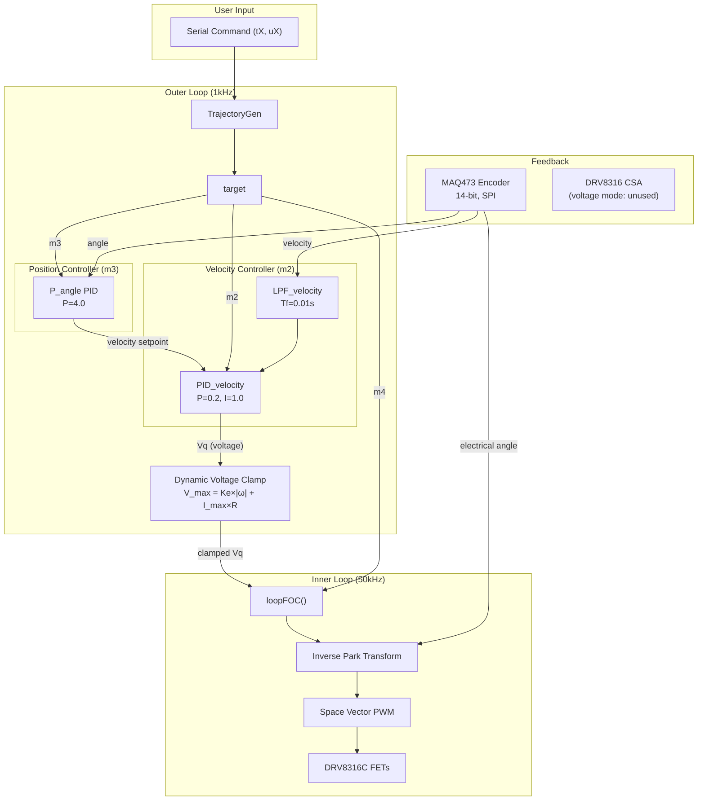

# Architecture & Design Decisions

## Overview

This firmware implements **Field-Oriented Control (FOC)** for a 7-pole-pair BLDC motor using the SimpleFOC library, with extensive hardware-specific adaptations for the STM32G431RB + DRV8316C platform.

---

## FOC Control Loop Block Diagram



---

## Control Modes in Detail

### Mode 0 — Velocity Open-Loop (`m0`)

```
target (rad/s) → acceleration ramp (20 rad/s²) → setPhaseVoltage()
```

- No sensor feedback in the velocity loop
- Sensor is still used for electrical angle (FOC commutation)
- Voltage limit: **1.5V** (stall-safe: I = V/(2R) ≈ 2.5A)
- Use case: initial motor checkout, sensor-less operation

### Mode 1 — Position Open-Loop (`m1`)

```
target (rad) → setPhaseVoltage() with velocity_limit=3 rad/s
```

- Steps through electrical angles like a stepper motor
- No position feedback
- Use case: verifying motor winding order, basic rotation test

### Mode 2 — Velocity Closed-Loop (`m2`)

```
target → accel ramp (2 rad/s²) → PID_velocity → Dynamic Clamp → loopFOC()
```

- Full sensor feedback: MAQ473 angle → velocity estimation → PID
- **Dynamic voltage clamp** active (see below)
- Torque control type: `voltage` (ADC not used in control loop)
- PID output = Vq voltage directly
- Output ramp: 10 V/s (prevents sudden voltage jumps)

### Mode 3 — Position Closed-Loop (`m3`)

```
target + pos_offset → P_angle → PID_velocity → loopFOC()
```

- Cascaded control: position P → velocity PI
- `pos_offset` is captured at mode entry, so target is always relative
- `t0` = stay where you are, `t3.14` = move 180° from mode-entry position
- Dynamic voltage clamp is **NOT applied** (would prevent startup from standstill)
- Protection relies on `velocity_limit=20 rad/s` and `output_ramp=10 V/s`

### Mode 4 — Torque (`m4`)

```
manual_target (Vq voltage) → loopFOC()
```

- Direct Uq voltage application — no PID, no ramp
- `u2.5` applies 2.5V to q-axis → motor produces constant torque
- Current is approximately I = (Vq - BEMF) / R
- Voltage limit: 4V (conservative default)
- Use case: torque characterization, haptic feel testing

---

## Dynamic Voltage Clamp — Design Rationale

### The Problem

In `voltage` torque mode, the PID output is a voltage, not a current. There is **no real-time current feedback** to prevent overcurrent. During acceleration, the PID can request a high voltage while BEMF is still low, causing:

```
I = (V_applied - BEMF) / R = (10V - 0V) / 0.32Ω = 31.25A  ← catastrophic!
```

### The Solution

Clamp the PID output so that the maximum possible current is physically limited:

```c
V_max = Ke × |ω| + I_MAX_SAFE × R
      = 0.088 × |shaft_velocity| + 1.5 × 0.32

if (motor.current_sp >  V_max) motor.current_sp =  V_max;
if (motor.current_sp < -V_max) motor.current_sp = -V_max;
```

### Why Not a Static Limit?

A static `voltage_limit = 4V` would work at low speeds but starve the motor at high speeds where BEMF exceeds 4V. The dynamic clamp adapts:

- At 0 rad/s: V_max = 0.48V (just enough to push 1.5A through R)
- At 30 rad/s: V_max = 3.12V (BEMF=2.64V + headroom for 1.5A)
- At 100 rad/s: V_max = 9.28V (BEMF=8.80V + headroom for 1.5A)

### Why Only in m2 (Velocity), Not m3 (Position)?

At standstill (ω=0), V_max = 0.48V. This is often not enough to overcome static friction. In position mode, the motor must start from standstill to reach a target angle. The clamp would create a deadlock:

```
ω=0 → V_max=0.48V → can't overcome friction → ω stays 0 → V_max stays 0.48V
```

Position mode relies on `velocity_limit` and `output_ramp` for protection instead.

---

## DRV8316C Register Configuration

### Why These Settings?

| Register | Setting | Reason |
|----------|---------|--------|
| PWM Mode | `3xPWM` | SimpleFOC's `BLDCDriver3PWM` drives INH pins; INL pins are enable pins driven HIGH for Active Freewheeling |
| Slew Rate | `200V/µs` (fastest) | Minimizes switching loss. 60ns transitions at 50kHz = only 0.11W switching loss. Slower slew increases dV/dt duration and FET heating |
| CSA Gain | `0.15V/A` | Lowest gain = largest measurement range (±11A). With jumper wire noise, lower gain means less noise amplification |
| OCP Mode | `NoAction` | **Diagnostic setting**: jumper wire ringing triggers false OCP at 16A+. NoAction prevents false shutdowns. Revert to `AutoRetry` on custom PCB |
| OCP Level | `24A` | Maximum threshold to reduce false trips from ringing |
| OCP Deglitch | `1.6µs` | Maximum deglitch time to filter out short ringing spikes |
| OCP CBC | `Enabled` | Cycle-by-cycle clear: each PWM cycle resets OCP, preventing permanent latch |
| Buck Voltage | `5.0V` | Powers DRV8316 internal logic |

### SDO Push-Pull Fix

The DRV8316 boots with open-drain SDO (MISO). Before the first SPI write, a pull-up is needed on MISO (PA6). The firmware:

1. Enables STM32 internal pull-up on PA6 via direct register write
2. Sends `setSDOMode(PushPull)` command
3. After this, pull-up is no longer needed

---

## JSQR Patch — STM32G4 HAL Bug Workaround

### The Bug

SimpleFOC calls `HAL_ADCEx_InjectedConfigChannel()` once per channel. On STM32G4, each call **overwrites the entire JSQR register** (injected sequence register). With 2 channels (PB0, PA1), only the last channel survives:

```
Call 1: JSQR = {JL=0, JSQ1=CH15}           ← CH15 (PB0) configured
Call 2: JSQR = {JL=0, JSQ1=CH2}            ← CH15 is GONE! Only CH2 (PA1) remains
```

### The Fix

After `initFOC()`, the firmware directly patches JSQR:

```c
JSQR = {JL=1, JSQ1=CH15, JSQ2=CH2, JEXTSEL=TIM1_TRGO, JEXTEN=rising}
```

This ensures both channels are sampled on every TIM1 TRGO trigger (PWM center).

---

## ADC Sampling Time Selection

| Setting | Sample Time | 2-ch Conversion | Effect |
|---------|-------------|-----------------|--------|
| SMPR=0 | 2.5 cycles | 706ns | Too noisy — insufficient settling for CSA output |
| **SMPR=1** | **6.5 cycles** | **894ns** | **Selected** — clean readings, fits within low-side ON window |
| SMPR=4 | 47.5 cycles | 2.82µs | Too slow — exceeds low-side ON time at high duty cycle, causes motor stall |

The low-side FET ON time at 50kHz and high duty cycle can be as short as 1~2µs. The ADC must complete both channel conversions within this window.

---

## Current Sense Offset Recalibration

### The Problem

`currentSense.init()` calibrates ADC offsets by averaging readings. But at init time, TIM1 hasn't started yet, so the injected ADC isn't running. Offsets calibrate to ~0V instead of the correct idle value (~1.49V).

### The Fix

After `initFOC()` (which starts TIM1), the firmware:

1. Disables the motor (no current flowing)
2. Waits 200ms for CSA to settle
3. Averages 1000 JDR readings
4. Writes corrected offsets to `currentSense.offset_ia/ib`

This ensures zero-current reads as 0A, not ±10A.

---

## Sensor LUT Calibration (`c` Command)

### Purpose

Magnetic encoders have sinusoidal nonlinearity due to magnet eccentricity, tilt, and stray fields. The LUT stores the error at 128 evenly-spaced positions and subtracts it in real-time.

### Procedure

1. Disable LUT (if active from previous calibration)
2. Drive motor open-loop through one full mechanical revolution (forward + backward)
3. At each of 128 positions: record `expected_angle - sensor_angle` = error
4. Average forward and backward passes to cancel cogging effects
5. Smooth with 5-tap moving average to remove noise spikes
6. Remove DC offset (absorbed by `zero_electric_angle`)
7. Enable LUT
8. Re-align `zero_electric_angle` to compensate for the angle shift

### Output

The calibration prints a C array that can be copy-pasted into the source code for permanent calibration without re-running the procedure.

---

## Motor Parameter Identification (`R` Command)

### What It Measures

| Parameter | Method | Typical Value |
|-----------|--------|---------------|
| R (phase resistance) | Apply DC voltage, measure current | 0.40Ω (MotorID) vs 0.32Ω (telemetry) |
| L (inductance) | Voltage step, measure di/dt | 37µH |
| Ke (back-EMF constant) | Spin at known voltage, measure speed | 0.136 V/(rad/s) (MotorID) vs 0.088 (telemetry) |

### Important Caveat

MotorID's Ke measurement (0.136) differs significantly from the telemetry-derived value (0.088). The telemetry value is more accurate because it's measured under real FOC operation at multiple speeds. The firmware's `config.h` uses the telemetry value (0.088).

If MotorID is run and auto-applied, manually verify Ke with a velocity sweep test before relying on it.
