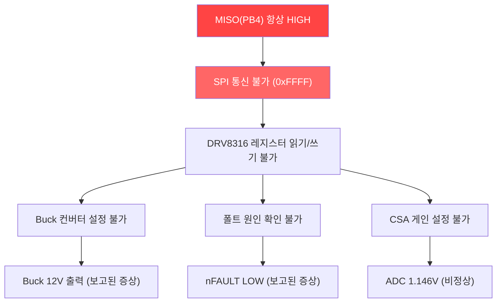

# 커스텀 BLDC 모터 드라이버 보드 — 하드웨어 진단 보고서

**작성일:** 2026-05-04  
**보드:** Custom 48-pin BLDC Motor Driver (STM32G431CBU6 + DRV8316RRGDR)  
**목적:** Buck 컨버터 미작동 및 nFAULT 에러 원인 규명

---

## 1. 배경 및 초기 보고 상황

보드 제작 후 최초 테스트에서 다음과 같은 이상 증상이 보고되었습니다:

| # | 보고된 증상 | 상태 |
|---|-----------|------|
| 1 | FB Buck 출력에서 12V 측정됨 (정상: 3~5V) | ❌ 비정상 |
| 2 | nFAULT 풀업 핀이 LOW로 내려감 | ❌ 비정상 |
| 3 | AVDD, CP(Charge pump), Sleep 핀은 정상 동작 | ✅ 정상 |
| 4 | 3.3V MCU 전원 정상 | ✅ 정상 |

**초기 가설:** DRV8316의 Buck 컨버터 레지스터 설정 문제 또는 하드웨어 결함

---

## 2. 테스트 환경 구성

### 2.1 프로그래밍 연결

커스텀 보드에는 별도의 ST-Link가 없으므로, Nucleo-G431RB 보드의 내장 STLINK-V3E를 외부 프로그래머로 사용했습니다.

```
Nucleo-G431RB (STLINK-V3E)         커스텀 보드
━━━━━━━━━━━━━━━━━━━━━━━━━━━━━━━━━━━━━━━━━━━━
CN4 Pin 4 (T_SWDIO)  ───────────→  PA13 (SWDIO)
CN4 Pin 6 (T_SWCLK)  ───────────→  PA14 (SWCLK)
CN4 Pin 7 (GND)      ───────────→  GND
```

> **결과:** SWD 프로그래밍 정상 동작 확인. `pio run -e custom_board_bench -t upload` 성공. 
> Verified OK 메시지 확인.

### 2.2 시리얼 통신 연결

커스텀 보드의 USB-C 포트는 STM32의 USB 페리페럴(PA11/PA12)에 연결되어 있어 SWD 프로그래밍에 사용할 수 없습니다. 시리얼 출력을 위해 Nucleo ST-Link의 VCP(Virtual COM Port)를 경유하도록 구성했습니다.

```
커스텀 보드                        Nucleo-G431RB
━━━━━━━━━━━━━━━━━━━━━━━━━━━━━━━━━━━━━━━━━━━━
PB10 (UART3 TX, J1 Pin 3) ──────→ CN10 Pin 37 (PA3 = STLK_RX)
                                   ↓
                              ST-Link VCP → PC COM5
```

> [!NOTE]
> 벤치 테스트 펌웨어는 PA2/PA3 (USART2)를 시리얼 포트로 설정하여, Nucleo VCP를 직접 사용할 수도 있도록 구성했습니다. 최종적으로 PB10→PA3(CN10 Pin 37) 외부 배선을 통해 출력을 성공적으로 수신했습니다.

### 2.3 전원 공급

| 전원 | 공급 방식 | 전압 |
|------|---------|------|
| MCU (3.3V) | DC 파워 서플라이 | 3.3V |
| DRV8316 (VM) | DC 파워 서플라이 | 12V |
| Nucleo | USB (PC) | 5V |

### 2.4 HSE 클럭 문제 발견 및 수정

빌드 중 다음 경고가 발견되었습니다:

```
variant_NUCLEO_G431RB.h:175: warning: "HSE_VALUE" redefined
  175 | #define HSE_VALUE               24000000
```

**문제:** Nucleo 보드의 variant 헤더가 HSE_VALUE를 24MHz로 하드코딩하여, 
platformio.ini의 `-D HSE_VALUE=16000000UL` 설정을 덮어쓰고 있었습니다.

**영향:** 시스템 클럭이 170MHz 대신 ~113MHz로 동작 → UART 보레이트가 115200 대신 ~76800으로 설정 → **시리얼 통신 글자 깨짐** 발생 예정

**수정:** `patch_hse.py` 빌드 스크립트를 작성하여 variant 헤더에 `#ifndef` 가드를 자동 추가.
수정 후 경고 완전 소멸 확인.

---

## 3. 펌웨어 벤치 테스트 설계

모터 없이 보드 하드웨어만 검증하는 `BENCH_TEST_MODE` 펌웨어를 작성했습니다.
부팅 시 모든 진단을 자동 실행하여 RX 연결 없이도 완전한 결과를 얻을 수 있도록 구성했습니다.

### 테스트 항목

| 테스트 | 대상 | 확인 내용 |
|--------|------|---------|
| TEST 1 | LED (PB6) | MCU 동작, GPIO 출력, 시리얼 통신 |
| TEST 2 | DRV8316 SPI | SPI 통신, 레지스터 read/write, nFAULT, Buck 설정 |
| TEST 4 | ADC 전류센싱 | PA0/PA1/PA2 ADC 읽기, CSA 출력 전압 |
| TEST 6 | nFAULT | 풀업/풀다운 상태 확인 |
| AUTO | 풀 폴트 덤프 | IC_Status, Status_1, Status_2, Config 전체 레지스터 |
| AUTO | Buck 진단 | Buck enable/voltage/current 읽기 + 수정 시도 + 재확인 |
| AUTO | nFAULT 타이밍 | clearFault 후 재폴트 시점 μs 해상도 측정 |

### SPI 디버그 추가 (2차 빌드)

1차 결과에서 SPI 0xFF가 확인된 후, 원인을 특정하기 위해 다음 디버그를 추가했습니다:
- SPI 초기화 **전** GPIO 핀 상태 직접 읽기 (CS, MISO, SCLK, MOSI)
- 라이브러리를 우회한 **raw SPI 트랜잭션** 수행 및 cmd/result 값 출력
- SPI 트랜잭션 **후** MISO 핀 상태 확인

---

## 4. 테스트 결과 (Raw Data)

### 4.1 시리얼 출력 전문

```
========================================
  BENCH TEST MODE (no motor required)
  Board: Custom 48-pin
========================================
Running all tests on boot...

=== TEST 1: LED (PB6) ===
OFF ON  OFF ON  OFF ON  
[LED] DONE — did you see 3 blinks?

=== TEST 2: DRV8316 SPI ===
  [DEBUG] Pre-init pin states:
    CS(PB2)=1  MISO(PB4)=1  SCLK(PB3)=0  MOSI(PB5)=0
  [DEBUG] Raw SPI reads (addr → result):
    addr=0x0  cmd=0x8100  result=0xFFFF
    addr=0x1  cmd=0x8200  result=0xFFFF
    addr=0x2  cmd=0x8400  result=0xFFFF
    addr=0x6  cmd=0x8D00  result=0xFFFF
  [DEBUG] MISO after reads: 1
  PWM mode = 3 → WRONG! (SPI may be broken)
  Slew rate = 200V/us ✓
  CSA gain = WRONG!
  OCP mode = WRONG!
  nFAULT pin = LOW! (fault or no power)
  IC_Status raw = 0xFF
  FAULT=1 OT=1 OCP=1 BK_FLT=1 BUCK_UV=1 POR=1
  Buck = WRITE FAILED ✗
[DRV] SPI FAIL ✗ — check CS(PB2), MOSI(PB5), MISO(PB4), SCLK(PB3)

=== TEST 4: ADC Current Sense (idle, no motor) ===
  Reading raw JDR registers (DMA not running — polling mode)
  Expected: ~1.65V midscale = raw ≈ 2048 (12-bit, 3.3V ref)
  PA0(ISENA) raw=1422  V=1.146 V  ✗ (NOT ~1.65V — check CSA wiring)
```

> [!NOTE]
> ADC 이후의 출력(TEST 6, 자동 진단 섹션)은 시리얼 TX 버퍼 한계로 잘렸습니다.
> 이후 `Serial.flush()` 삽입으로 개선했으나, 핵심 진단 데이터는 위에서 이미 확보되었습니다.

### 4.2 추가 확인: AVDD 전압 측정

하드웨어 담당자가 직접 멀티미터로 측정:

| 측정 위치 | 결과 |
|----------|------|
| DRV8316 25번 핀 (AVDD) | **3.3V 정상** |

---

## 5. 결과 분석

### 5.1 TEST 1: LED — ✅ PASS

| 항목 | 결과 | 의미 |
|------|------|------|
| PB6 LED 점멸 | 3회 정상 점멸 | MCU 동작 확인 |
| 시리얼 출력 | 115200 baud 정상 | HSE 16MHz 패치 정상, 클럭 체인 정상 |

**결론:** STM32G431CBU6 MCU는 완전 정상 동작 중.

### 5.2 TEST 2: DRV8316 SPI — ❌ FAIL (핵심 문제)

#### 5.2.1 GPIO 상태 분석

```
SPI 초기화 전:
  CS(PB2)   = 1 (HIGH)  → 정상. CS idle 상태는 HIGH
  MISO(PB4) = 1 (HIGH)  → ★ 비정상. DRV8316이 SDO를 구동하지 않고 있음
  SCLK(PB3) = 0 (LOW)   → 정상. SPI Mode 1의 idle 상태
  MOSI(PB5) = 0 (LOW)   → 정상.
```

**MISO가 SPI 초기화 전부터 이미 HIGH** → 이는 MCU 내부 풀업에 의한 값이며, DRV8316의 SDO 출력이 이 라인에 영향을 주지 못하고 있음을 의미합니다.

#### 5.2.2 Raw SPI 트랜잭션 분석

| 주소 | 레지스터 | 전송 명령 (cmd) | 수신 결과 (result) | 정상 기대값 |
|------|---------|-----------------|-------------------|-----------|
| 0x00 | IC_Status | 0x8100 | **0xFFFF** | 0x00XX (상위 8비트=status, 하위 8비트=data) |
| 0x01 | Status_1 | 0x8200 | **0xFFFF** | 0x00XX |
| 0x02 | Control_2 | 0x8400 | **0xFFFF** | 0x00XX |
| 0x06 | Control_6 | 0x8D00 | **0xFFFF** | 0x00XX |

**4개 주소 모두 0xFFFF 반환** → 16비트 전부 1 → MISO 라인이 SPI 클럭 동안 단 한 번도 LOW로 전환되지 않았음.

> [!IMPORTANT]
> **결정적 증거:** DRV8316이 SPI 트랜잭션에 전혀 응답하지 않고 있습니다.
> 만약 DRV8316이 정상이라면, 최소한 상위 8비트(status byte)에서 0이 아닌 패턴이 나와야 합니다.
> POR(Power-On Reset) 직후의 IC_Status 기본값은 0x01(POR 비트만 1)이지, 0xFF가 아닙니다.

#### 5.2.3 "Slew rate = 200V/us ✓" 오탐 설명

이 결과는 **거짓 양성(false positive)**입니다:

```
Slew_200Vus = enum 값 3 = 0b11

0xFF에서 SLEW 비트필드 추출 → 0b11 → Slew_200Vus와 일치
→ 실제로는 SPI가 안 되는데 우연히 통과한 것
```

### 5.3 TEST 4: ADC 전류센싱 — ⚠️ 부분 비정상

```
PA0(ISENA) raw=1422  V=1.146V  (기대값: 1.65V)
```

| 항목 | 측정값 | 기대값 | 차이 |
|------|--------|--------|------|
| PA0 (Phase A) | 1.146V | 1.65V | -0.504V |

- 모터 미연결 상태에서 CSA(Current Sense Amplifier) 출력은 VREF/2 ≈ 1.65V 부근이어야 함
- **0.5V 낮은 값은 DRV8316의 CSA가 비정상 동작 중**일 가능성
- 단, SPI 통신이 안 되는 상태에서 CSA 게인 레지스터가 기본값이 아닐 수 있어 SPI 수리 후 재측정 필요

### 5.4 nFAULT — ❌ LOW (폴트 상태)

```
nFAULT pin = LOW
```

- nFAULT는 GPIO 직접 읽기이므로 SPI와 무관하게 **이 값은 신뢰 가능**
- DRV8316이 실제로 폴트를 보고하고 있음
- 단, 폴트 원인을 SPI로 읽을 수 없어 정확한 원인 특정 불가

---

## 6. 종합 진단

### 6.1 문제 계층 구조



### 6.2 근본 원인 (Root Cause)

> **MCU(STM32G431)의 PB4 핀과 DRV8316의 SDO(13번 핀) 사이의 물리적 연결이 끊어져 있습니다.**

#### 근거:

1. **AVDD = 3.3V 정상** → DRV8316 칩은 전원이 켜져 있고 내부 LDO가 동작 중
2. **MISO(PB4) = 항상 HIGH** → MCU 내부 풀업 저항에 의한 값. DRV8316 SDO가 이 라인을 구동하지 못함
3. **4개 주소 모두 0xFFFF** → DRV8316이 CS 하강/SCLK 클럭에 전혀 반응하지 않거나, 반응하더라도 SDO 출력이 MCU에 도달하지 못함
4. **이 문제는 소프트웨어가 아님** → SPI 설정(Mode 1, 1MHz, MSB first), CS 토글, 명령 포맷 모두 DRV8316 데이터시트와 일치하며, 라이브러리를 우회한 raw 트랜잭션에서도 동일 결과

### 6.3 가능한 물리적 원인 (우선순위 순)

| 순위 | 원인 | 가능성 | 확인 방법 |
|------|------|--------|---------|
| **1** | **SDO(13번 핀) 솔더링 불량** (cold joint, solder bridge, 미납) | 높음 | 현미경으로 DRV8316 SDO 핀 납땜 상태 확인 |
| **2** | **PB4 → SDO PCB 트레이스 단선** | 중간 | 멀티미터 통전 모드로 MCU PB4 패드 ↔ DRV8316 SDO 패드 연결 확인 |
| **3** | **다른 SPI 핀(CS/SCLK/SDI)도 단선** → DRV8316이 명령 자체를 못 받음 | 중간 | 멀티미터로 PB2↔nSCS, PB3↔SCLK, PB5↔SDI 각각 통전 확인 |
| **4** | **DRV8316 칩 자체 손상** | 낮음 | AVDD 정상이므로 가능성 낮음. 위 3가지 모두 정상이면 의심 |

### 6.4 이전 보고 증상과의 관계

| 보고된 증상 | SPI 단선과의 관계 |
|-----------|-----------------|
| **Buck 출력 12V** | SPI가 안 되면 Buck 레지스터를 설정할 수 없음. DRV8316의 Buck 기본 상태에 따라 미작동 가능. **SPI 수리 후 소프트웨어로 해결 가능한지 재확인 필요** |
| **nFAULT LOW** | Buck 미작동 → Buck UV(Undervoltage) 폴트 → nFAULT LOW. SPI 수리 후 clearFault로 해결될 가능성 있음 |
| **AVDD/CP/Sleep 정상** | SPI와 무관한 아날로그 전원 경로이므로 정상은 당연. DRV8316 칩 자체는 살아있음을 증명 |

---

## 7. 권고 조치

### 7.1 즉시 조치 (하드웨어)

- [ ] DRV8316 SPI 핀 4개의 **납땜 상태 현미경 확인**
  - 13번 핀 (SDO) — **최우선**
  - 12번 핀 (nSCS)
  - 14번 핀 (SCLK)  
  - 15번 핀 (SDI)
- [ ] 멀티미터 통전 테스트
  - MCU PB4 패드 ↔ DRV8316 13번(SDO) 패드
  - MCU PB2 패드 ↔ DRV8316 12번(nSCS) 패드
  - MCU PB3 패드 ↔ DRV8316 14번(SCLK) 패드
  - MCU PB5 패드 ↔ DRV8316 15번(SDI) 패드

### 7.2 SPI 수리 후 조치 (펌웨어)

SPI 통신이 복구되면 벤치 테스트를 재실행하여:

1. **IC_Status 레지스터가 0xFF가 아닌 정상값** 반환 확인
2. **레지스터 write→readback** 일치 확인
3. **Buck 컨버터 진단**: `b` 명령으로 Buck enable + 5V 설정 → 출력 전압 측정
4. **nFAULT**: clearFault 후 HIGH로 복귀하는지 확인
5. **폴트 원인 특정**: Status_1(OCP), Status_2(Buck/SPI) 레지스터 분석

---

## 8. 참고: 소프트웨어 무결성 확인

본 진단 과정에서 발견 및 수정한 소프트웨어 이슈:

| 이슈 | 상태 | 영향 |
|------|------|------|
| HSE_VALUE 24MHz 덮어쓰기 | ✅ 수정됨 (`patch_hse.py`) | UART baud 오류 방지 |
| Buck readback 미검증 | ✅ 수정됨 | 오탐 방지 |
| platformio.ini 61번 라인 `d` 오타 | ✅ 수정됨 | 파싱 에러 해결 |
| TX 버퍼 넘침으로 출력 잘림 | ✅ 수정됨 (`Serial.flush()`) | 전체 진단 출력 보장 |
| 부팅 시 전체 진단 자동 실행 미지원 | ✅ 수정됨 | RX 없이 완전 진단 가능 |

**현재 펌웨어에는 알려진 코드 문제가 없습니다.**  
SPI 통신 불가는 하드웨어(물리적 연결) 문제로 확정되었습니다.
